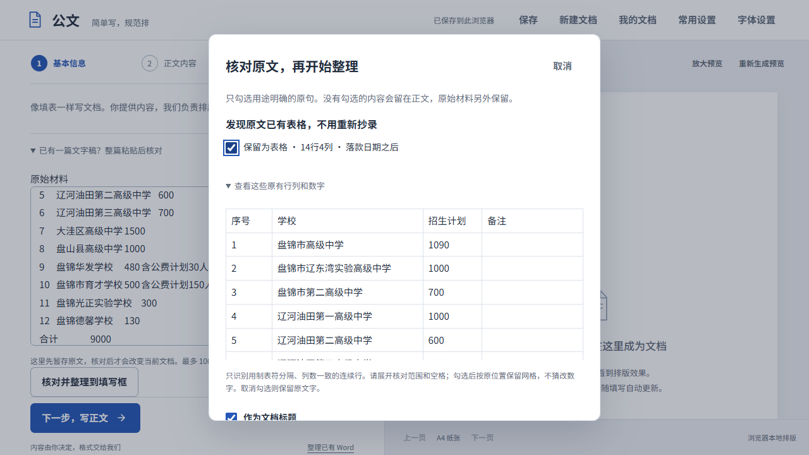
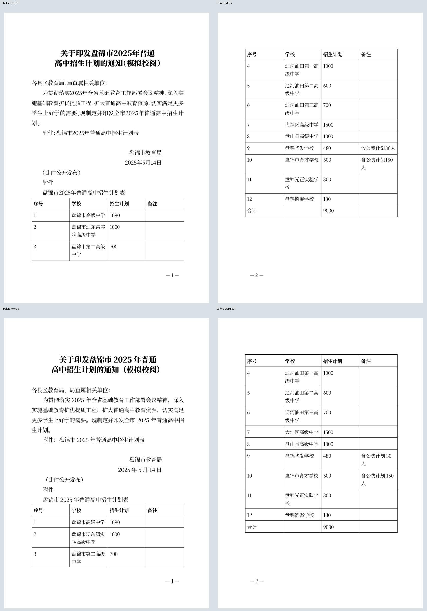
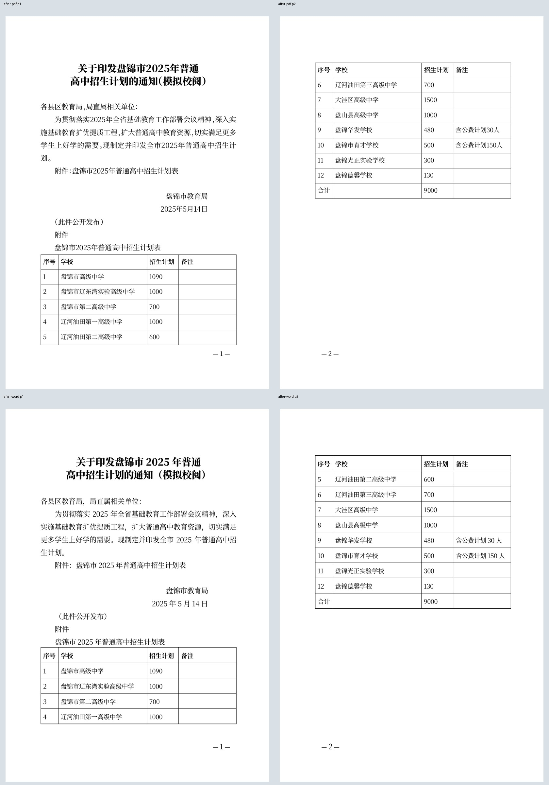

# 招生计划经办：不重抄原表，按内容分配核对空间

2026-10-22；回应CEO main12d961f/593e0e45的CEO-004/002 P1和CEO-003/002 P2，继续同一分支/PR #5，不合并或公开部署。

## 岗位工作与原表事实

使用[盘锦市教育局公开的2025年普通高中招生计划通知](https://jyj.panjin.gov.cn/2025_05/14_10/content-520850.html)，经办人从整篇材料整理为历史模拟校阅稿。原表12校、14×4、56格、12空格，各校计划相加9000；华发480内含公费30、育才500内含公费150，不能另加。历史署名日期2025年5月14日保留，仅标题追加模拟校阅标记，不发布真实招生安排。

原页面HTML中的视觉空格被归一到可核对文字；合计合并格展开为“合计/空格/9000/空格”，不新增或省略行。固定输入见scripts/fixtures/writer-admissions-plan.json。本轮是实施者知情的岗位任务验收，不是新的盲测或真实经办人研究。独立浏览器正常UI填写，没有草稿/存储注入；Worker观察仅记录模型与实际Wasm响应字节，不改业务参数。

## P1：整篇整理时直接确认现有表格

材料核对区域直接展示“发现原文已有表格，不用重新抄录”，标明14行4列及其在正文或落款后的原位置，可展开查看全部56格。默认不勾选；使用者明确确认后，整理即保留原位可编辑网格，无须先删源表、另建空表或重录44个非空格。取消保持原输入；不选择转换仍保留原文字，不偷偷猜普通空格或不等列数行。

只识别2–100行、2–10列的明确制表文本。表头、空行/空单元格、后面的说明不丢；整理空行时也不合并表行。末尾只含制表符的空回执行原先可能被边缘清理吞掉，必要回归发现后同步修正。长纯文字材料不被发现功能强制套入结构段落上限，确认后若超限有明确错误且保留原稿。

网页“发布日期”与原通知日期分开标明，勾选才从公文内容排除，原始材料完整保存。该信息夹在标题与收文对象之间时，不再挡住紧随的收文对象候选；候选仍由经办人确认，不把抓取文本都自动视为原公文。

## P2：空间服务于学校、人数和包含关系

正常填写稿的有数据表按各列内容需要分配空间：本题四列从39/39/39/39mm改为约14/70.76/25.24/46.01mm。学校与备注得到足够空间，序号/人数不占同样宽度。字号14、行高规则、页边距、所有字句/数字及顺序不改；空白回执继续等宽，保留填写空间。导入Word原件不经过这个填写稿推导，不改其原列宽。

短附件标识和标题连到表头及开始数据；表头与首数据行、末数据与明确合计行保持阅读关系。直接PDF尊重新稿的行内keepNext关系，过大组合不强拖整页；源件行为由针对性回归保护。合计不增减，仍有合理续表，不要求一页或Word/PDF逐页相同。

本机固定转写稿的旧新直接PDF都是2页，Word也都是2页；**没有取得CEO的3页原保存文件，不冒称“3→2”同稿改进**。旧列宽中的多行校名及备注“人”短尾在新版完整一行显示；新PDF第2页含第6至12校及合计，Word第2页含第5至12校及合计，列含义通过重复表头保留。附件/标题/第一校同页，末校/合计同页，未留一页只有合计。

## 当前证据与边界

- 最终Chrome/Firefox/WebKit各9项任务核对，共27项；旧基线明确手工归位被网页元数据遮挡的收文对象，并删除网页发布信息，再用已有插表确认，不能说成旧版已经自动完成。
- 共8份真实Word/PDF，8页直接PDF全文/顺序逐字校验，56格/12空格/9000及两公费备注完整一致。两份Chrome原生Word16.0全文SHA与实际文件绑定；附件/表题/首校、末校/合计物理页码检查。四份代表成品共8页全部渲染查看，无裁切、缺字、重叠或表线丢失。
- 39项相关Node回归、Go真实PDF行关系针对性测试、全量go test ./...与go vet ./...通过。最终资产另跑制造企业双表历史复制完整任务6项，保护上一修复。
- 本地4173原样同步最终QA资产，实际地址再完成9项及两份新下载，全文/56格核对；服务Word字节与原生代表文件相同。浏览器实际Wasm响应SHA与目标构建一致，HTTP各新旧模块和Wasm逐一对应，沿用原隐藏服务，不重建提交后的另一份未验引擎。

[独立内容/行列/页码和源指纹](evidence/admissions/verified.json)、[原生Word结果](evidence/admissions/word-render.json)、[实际服务复验](evidence/admissions/service.json)。同目录保存前后输入/模型、三浏览器结果与完整页组。正常原稿、历史日期和事实不因流程优化被改写。没有真实中文选词、手机、真机Safari、物理打印、所有未知表格或独立首次发现率的新通过声明。任意Word合并格自动恢复也未承诺。

复现：旧验收资产固定build/qa/admissions-before-web；新构建build/qa/admissions-web，运行test-writer-admissions.mjs --baseline与不带baseline，ADMISSIONS_PROFILE取chrome/firefox/webkit。运行verify-admissions-word.ps1只读导出原生页并取段落物理页码，再运行verify-writer-admissions.py全文/56格/包含关系核验与渲染；仍须实际查看图片。ADMISSIONS_URL/ADMISSIONS_OUTPUT可用于固定服务隔离复验，不覆盖QA结果。

验证经历：首轮基线脚本假设旧版会提出被元数据遮挡的收文候选而超时，已按旧实际手工路径重跑；新版本补了候选定位。首个Word Find遍历停滞，按命令与时间确认后只终止本轮隐藏验证进程，改为有界的原生段落扫描；用户另开的Word未操作，未把脚本问题误报为产品问题。

## 后续完整反馈方案

最新docs/FEEDBACK-PRODUCT.md已完整读取并保留排队，不以省开发成本裁成文字留言框。下一项覆盖本地可检查证据副本、明确确认、可靠接收/回执、补充/回复/删除及内部处理；正常文稿仍本地。接收运营主体、权限及保存删除规则未确定前不能开放真实接收，不把产品文档当作账号权限、数据上传或公开部署授权。本轮没有实现/开通反馈服务，也未上传用户稿件。
