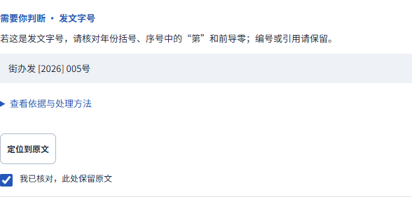

# 同一原稿保存后继续沿用已核对的判断

2026-10-21；CEO-001/006后续P2，来源CEO文件blobeb1e488892c4ac5341f3077fb6737b488d6af6d2、main ce8018f9。继续同一分支与PR5。

## 缺口与结果

已交付版本确实只保存文稿字段，判断账本在内存中。独立Chrome基线复现：对“街办发 [2026] 005号”明确保留，保存刷新后文号原样恢复，但确认清空、下载禁用。此前“本标签页有效、不承诺跨刷新”不足以支持常见中断后的工作，此边界被本轮要求替代。

本轮将已经完成的核对记录作为可选元数据随本地原稿保存。刷新、关闭重开、从“我的文档”继续同一原稿时，仍先完成当前排版与检查，再用规则版本、依据、原句、建议、严重程度、段落格式和相关内容精确匹配，使用最新检查ID导出。没有直接复用旧引擎ID或跳过新检查。

同稿无关标题改动可以继续沿用文号判断；改序号、修改相关正文、主动取消确认、出现歧义重复或检查依据变化时重新判断。撤销文字改动不会复活已失效判断。正文和文号的独立记录分别处理，取消一处不清空另一处。

新建、复制是新文档，不继承判断。库内“继续编辑”恢复原文档身份及其记录。下载快照导入沿用已有“新本地副本”政策，明确提示重新核对，原稿仍可在库内继续；不把旧ID及判断静默扩散到导入副本。草稿仍兼容v1/v2/v3；可选记录损坏或版本不支持时忽略该记录，已写文字不因此打不开。

填写阶段先选“保留”、而排版检查尚未完成时，界面说明核对后才保存这次判断；本轮没有将尚未匹配检查依据的意向当作已持久确认。确认后即自动保存，也可使用原“保存”按钮，不增加账户或审批中心。

## 当前验证

- 三浏览器Chrome155/Firefox157/WebKit27.2各14项，共42/42：完整“保留→保存→刷新/重开→实际导出”，无关改动、库内原稿、新副本、撤销确认、改序号、正文独立判断均覆盖。没有运行异常。
- Node44/44，包括保存键序列化、同稿匹配、新稿隔离、规则/依据/严重程度/建议/格式/版本变化失效、坏元数据保全文字。旧提醒66/66、启动33/33、Chrome首次16/16、跨标签恢复及旧缓存升级通过。
- 真实下载后独立核验三浏览器PDF各1页，原文号、最新标题、正文完整；Chrome实际Word逐段原字符/空格精确相符，TXT保留原文号。隐藏Microsoft Word16.0打开当前Word为1页，直接PDF与Word代表页均已查看，无裁切或叠字。当前源码与验收构建哈希逐项匹配。没有修改Go生成、文档字体或分页，未用旧轮Go测试冒充当前验证。
- 本轮还发现并修复WebKit首次“保留”点击被失焦重绘吞掉：原保护依赖relatedTarget过窄。按钮按下到点击完成前不再重绘其提示；完整自然点击通过，不加重试或放宽断言。新文案UI字形全部已覆盖，无需重新生成字体。

[基线](evidence/ceo-review-recovery/baseline.json)、[三浏览器](evidence/ceo-review-recovery/browser-checks.json)、[实际文件与源码哈希](evidence/ceo-review-recovery/verified.json)、[隐藏Word记录](evidence/ceo-review-recovery/word-render.json)随Git保存。复现脚本为`test-writer-review-recovery.mjs`与`verify-writer-review-recovery.py`；最终构建在`build/qa/ceo-review-web`。这不是所有浏览器持久化能力、其他机器Word版式或全面合规证明。

[真实PDF画布](evidence/ceo-review-recovery/restored-preview.png)、[隐藏Word页面](evidence/ceo-review-recovery/restored-word.png)。

CEO本轮已补齐上版的保留/撤销、暖态短长稿保守采样和四份实际Word/PDF检查，先前“这些尚未测”的说明已被新事实替代；其Word只做ZIP/XML，不改写为Microsoft Word视觉验收。后续CEO文件fef52968对86e606a的原稿显式刷新、文号/正文判断及副本隔离提供了核心独立UI支持；不是全部浏览器、实际新成品或主线集成接受。医院材料前言/空行及复合关系分别在后续回应验收，不由这一项替代。
