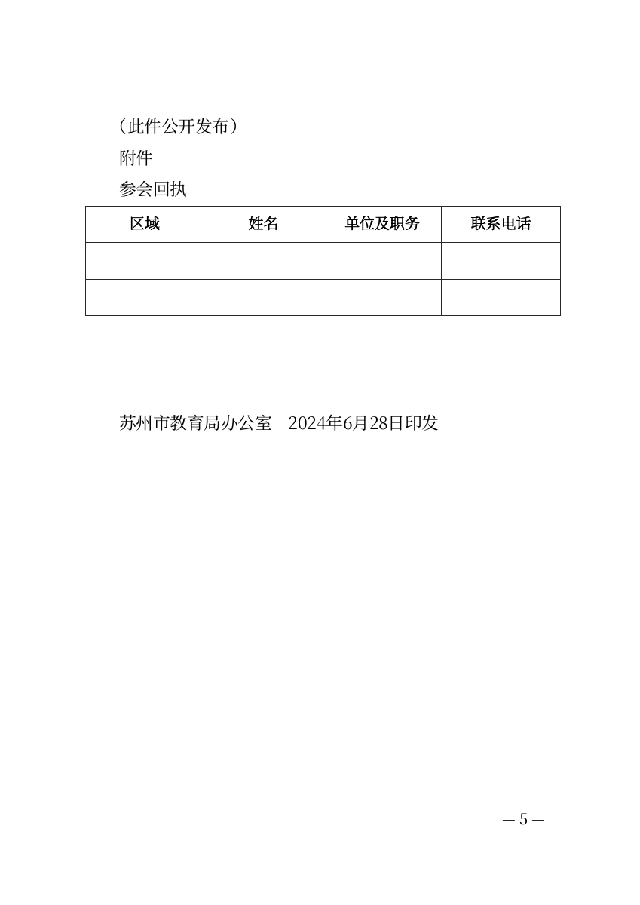
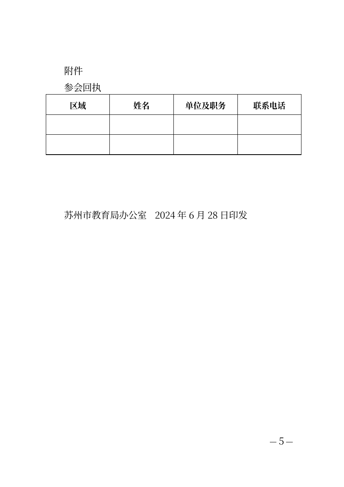

# 教育通知与空白回执：从当前填写稿继续

2026-10-21；关联CEO-002、004，延续PR #5。来源为CEO文件blob8fb6413645eb711646befc7554c93d42fb1b50a5（main35522da），本轮实际产品源码为e013681/7791e42，未修改产品代码、字体或分页。

## 结果与实际取舍

现有“当前填写草稿副本→高级编辑”路径可以完成这份通知的回执结构：不用重录通知，表格放在落款后的回执标题处，保留公开说明及表后印发信息。此前只有文字的四列表头可明确替换为一张三行四列表格，其中两行全部为空。没有自动恢复任意网页表格，也没有据CEO环境的文件选择超时新增功能或绕过其授权流程。

本轮使用[苏州市政府公开原文](https://www.suzhou.gov.cn/szsrmzf/bmwj/202407/5c69d24ed36c4039ad68666612534856.shtml)，把HTML正文、原表空白单元格与印发文字转为测试用纯文本。仅合并两个标题行和规范HTML空白，正文1521个非空白字符，加官网文号13字符，共1534字符。成文/印发仍为2024-06-28，未改成网页发布日期2024-07-01。公开原文中既有联系人信息按原样保留；空白回执未增加任何个人信息，未发送或对外发布。

## 可复现的现有操作

1. 在填写页整篇粘贴、核对标题/主送/署名/历史日期及其后附注；文号按官网单独填写。署名后“公开说明、附件、回执文字、印发信息”仍在附注中。
2. 正文旁展开“需要添加表格？”，下载当前填写草稿副本，打开高级编辑，选择该副本。“编辑正文”可见已有通知全文。
3. 仅清空将被表格替代的那段四列表头文字，避免重复。选中原“参会回执”标题段，在其后添加表格；粘贴四列表头及两个空白行，列间保留Tab分隔符，空白行也包含三个Tab。取消三线表以使用网格线，可选择居中。表格标题留空，沿用已有回执标题。
4. 核对表后原有印发文字，再导出Word/PDF。原填写稿仍保留，表格副本不会自动反传。添加可撤销；刷新后副本中的表格及原文字继续保留。

这里仍有下载后选文件、清空文本表头、复制含Tab空行等操作成本，不把脚本成功当成普通人无需解释即可完成。原空行对应的空段未删除；产品不提供回执专用模板、自动表格识别或原表尺寸复刻。

## 本轮证据

- Windows、无头桌面1440×1000、Chrome155/Firefox157/WebKit27.2，三浏览器各9项，共27/27。覆盖原文及历史日期、全部字段副本、表格真实结构与位置、撤销、刷新恢复、原稿不变、无运行异常。
- 每浏览器实际导出填写稿、未改副本、含回执副本各一组Word/PDF，共9组18份文件。独立解析包/XML及实际PDF：1534字符和顺序逐项完全相符；填写稿/未改副本无表，最终恰有一张表，表头及全部空白单元格与原表结构一致。9份PDF各5页，共45页文本核验，不把它们都计为逐页视觉检查。
- 隐藏Microsoft Word16.0实际打开Chrome三份Word，均5页；其SHA256与最后三浏览器运行导出的当前Chrome文件相符。填写稿与未改副本字节相同，去重后填写稿/最终稿的Word和直接PDF共20个代表页全部渲染查看。最终第5页回执完整、表后印发信息未丢失，未见表格裁切或叠字。
- 页面边界仍存在：Word中长网址/邮箱前一行两端对齐会拉宽字距，直接PDF第3页留白较多；两者在本轮表格前后均存在。原官网每行约2cm且列宽不等，本轮使用现有通用表格的等列宽、默认行高，未声称原表外观保真。若交付要求严格尺寸，仍需后续明确验证或Word调整。PDF是可打印的空白表格，不是带交互字段的AcroForm。
- 本轮仅新增真实任务回归、独立文件核验与说明，不重跑或冒认旧Go/模型结果。固定用户服务4173保持原验收资产、后台健康，无需为没有产品变化的这轮重复构建。

[浏览器检查](evidence/ceo-002-education/browser-checks.json)、[实际成品及源码哈希](evidence/ceo-002-education/verified.json)、[隐藏Word打开记录](evidence/ceo-002-education/word-render.json)随Git保存。复现：构建到`build/qa/ceo-002-education-web`，运行`scripts/test-writer-education-receipt.mjs`及`scripts/verify-writer-education-receipt.py`，浏览器依赖沿用`scripts/browser-tests`；本机实际文件保留在`build/qa/ceo-002-education`，不提交多份嵌入字体的大文件。

此结果为实施方的真实流程与成品验证，未将CEO独立体验标记完成，也不关闭仍待其复验的CEO-005/006。医院任务、手机及全面版式合规未新增完成声明。

后续事实：main e0f85ff、CEO文件blob5e9f5692记录原7791e42教育恢复最终成功，体验者未重导，从已载入副本完成回执；实际Word全文/3×4空白表格与5页PDF均已核验，历史日期、文号和表后印发信息保留。该独立连续任务现已完成，前文未完成状态保留为当时边界；CEO的Word仍仅结构/文本核验，不能改写成Microsoft Word视觉验收，也不等于PR已合并或授权发布。
