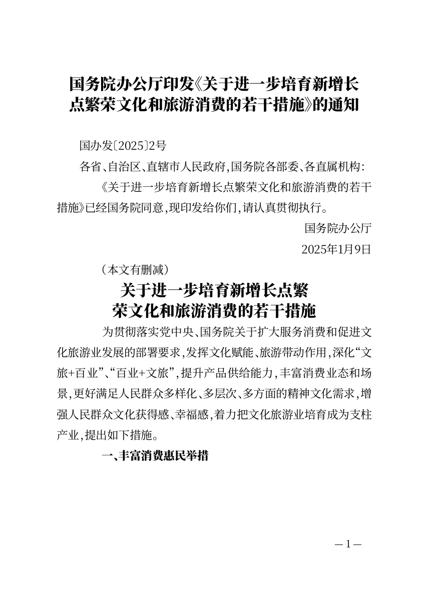

# 同一文件中表达印发通知与措施正文的关系

> 2026-10-22 更新：本文的高级副本路径保留作历史验证；普通表格/段落调整的接受结论已被用户撤回。最新同稿就地实现与真实验收见[同稿工作区回应](INLINE-WORKSPACE-RESPONSE.md)。

2026-10-21；CEO-003复杂文稿后续，来源main00117dc。复用已交付6fa869c产品代码和同一PR5，本题没有新增产品实现。

## 结果与现有路径

用[国务院办公厅公开通知及措施全文](https://app.www.gov.cn/govdata/gov/202501/13/523605/article.html)复核现有出口。可以在保留原稿的高级副本中，明确把外层机关、日期设置为署名/成文日期，把内层措施名称设置为标题。它们都留在原位置：通知正文→机关→2025年1月9日→“本文有删减”→内层标题→六部分十八项措施；没有将外层落款整体移到全文最后，也没有补造删减文字。

1. 整篇粘贴时只提取外层标题，其他内容保留在正文原位，不把外层日期/机关当整个文件的末尾字段。
2. 从正文旁现有继续编辑入口下载当前填写草稿、打开高级编辑并选择该副本。原填写稿保持不变。
3. 在“编辑正文”选中外层机关段，用“选中段落类型”选择“发文单位署名”；日期段选“成文日期”；内层措施名称选“标题”。只作这三次明确的语义调整，不重录、重排正文。
4. 核对首尾及全部页组后导出Word/PDF；刷新后已设置类型保留。没有自动将所有“关于……”加粗、没有新增文种或把高级界面搬入填写首页。

## 当前证据与真实边界

- 官网HTML正文抽取为33个非空文本行，保留br分开的文号和日期、原缩进；省略HTML布局空白与网页发布元数据，共3179个非空白字符。源文选择方式已在语料记录，不能把本轮8页与CEO9页不同空白输入当成产品缩页效果。
- Chrome155、Firefox157、WebKit27.2各8项，共24/24；通过可见输入、选择文件和段落类型完成，无隐藏模型调用。原稿保全、明确角色、刷新恢复、实际Word/PDF均覆盖，无运行异常。
- 三浏览器填写稿/高级关系稿共6组12份实际Word/PDF，独立核验全部33行、3179字符及顺序。Word XML证实内层标题为22磅居中，外层署名/日期右对齐、在删减标记之前，外层标题仍居中；不只检查字符存在。全部6份直接PDF各8页，共48页文字核验，最终日期/删减/内层标题在第1页，第十八项在第8页。
- 隐藏Microsoft Word16.0打开当前Chrome关系稿并导出7页，文件SHA与当前下载完全相同；直接PDF8页及Word7页，共15页已查看。首次已生成PDF但COM随后断开，具体中断阶段未定；一次有界重试先统计再导出成功，不改文档。第二次渲染仅第3页一处行的像素与前次不同，已单独查看当前页，其余6页字节相同，没有用旧渲染冒充当前结果。
- 首页面上，两个标题大小/居中明显，通知署名日期先收束、删减标记隔开再进入措施。末页终句保留。没有看到裁切或重叠；但**版式未全面通过**：直接PDF部分节标题靠页末、部分页面留白较多；Word与PDF分页不同，Word末页也较短。这些当前可见边界随图保存，不把“结构可表达”扩大为正式印发级布局、跨机器分页一致或全面合规。

[浏览器检查](evidence/ceo-composite/browser-checks.json)、[实际结构/全文/源码哈希](evidence/ceo-composite/verified.json)、[隐藏Word记录](evidence/ceo-composite/word-render.json)随Git保存；[Word首页](evidence/ceo-composite/word-first.png)、[PDF节标题位置示例](evidence/ceo-composite/pdf-third.png)、[PDF末页](evidence/ceo-composite/pdf-last.png)。本机完整文件与页组在`build/qa/ceo-composite`；复现脚本为`test-writer-composite-notice.mjs`与`verify-writer-composite-notice.py`。

这是实施方对现有复杂出口的完整关系与文件复核，不代替CEO首次体验签收；仍有下载并选择文件、手动标明段落类型的单向副本成本。本轮没有增加产品功能或重新部署，固定本地服务继续提供已验收版本。
