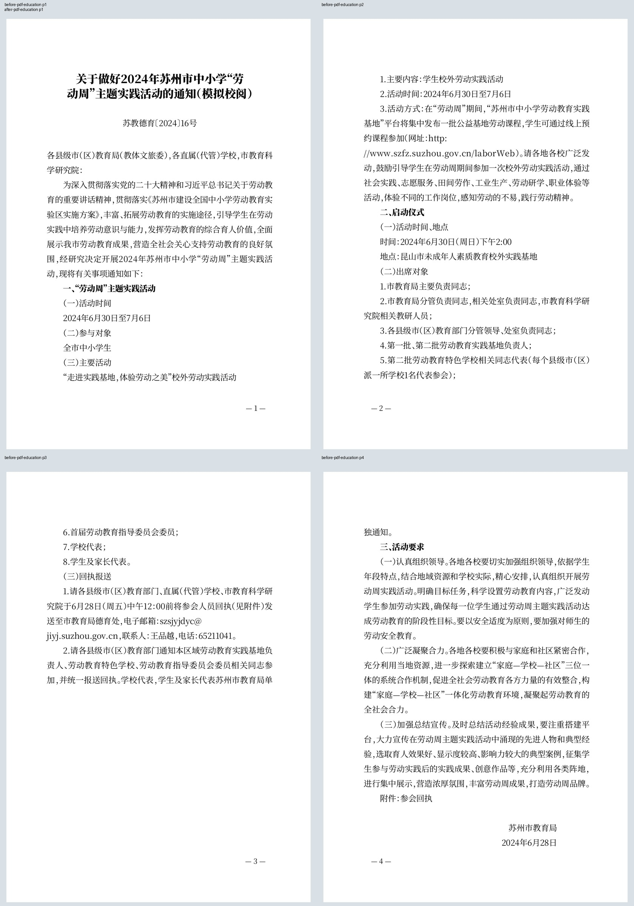
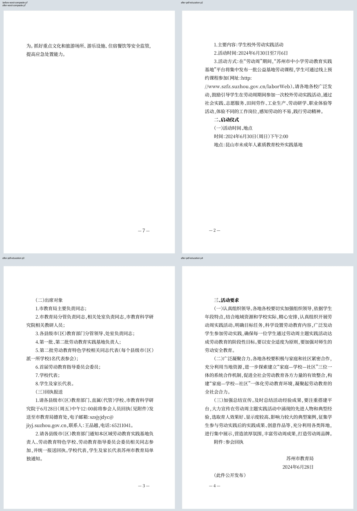
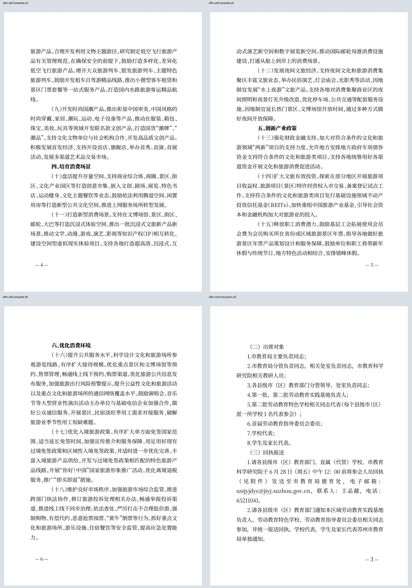

# CEO-003：跨页阅读质量的本轮改进

2026-10-22；回应mainb99c894f的P2，沿用同一codex/ceo-004-materials/PR5，不合并或公开部署。最新小时评价补齐了7ddb医院采购任务，未新增规则任务；本轮继续聚焦教育/复合稿跨页问题。

## 同一稿件前后有什么变化

固定使用7ddb实际界面保存的两份草稿，保持同一ID、完整字段和结构。在旧构建和新构建分别恢复、预览并通过普通下载按钮取得Word/PDF；没有改写正文、删除空行、调整字号行距、改变页边距或要求作者试参数。

| 代表问题 | 修改前 | 修改后 |
| --- | --- | --- |
| 复合通知的节标题与正文 | 本机固定输入8页，前三节标题在前页末，所属内容在下一页 | 6页，六节全部与所属正文开头同页；四/五/六节分别在第4/5/6页 |
| 教育通知的第三四页 | 第3页末“单”，第4页首“独通知。”，剩余空间明显 | 仍为5页，第3页完整收束“单独通知。”，第4页从“活动要求”及其首段开始 |
| 日期后的短公开说明 | 初次试排曾使Word短说明与日期分离 | 最终PDF日期和说明同第4页，Word同第5页；署名、说明、回执和印发信息仍按原序 |
| 原生Word边界 | 教育第3页末有“活动要求”标题，首段在第4页；复合7页 | 教育标题与首段同第4页，日期与短说明同第5页；复合仍7页，六节与正文同页，前后图像一致 |

本机复合基线是8页，**没有取得并复刻CEO的9页原文件，不能宣称“9→6”同稿改进**。本机8页稿确有同类孤立标题；所有六节、全部3179非空白字符和十八项措施均逐项核对。教育校阅稿1540字符，包含明确的模拟标题后缀，原文、历史日期和3×4回执保持。本轮没有把减少页数当验收指标，Word复合的正常短末页继续允许。

## 根因与局部修订

代码已有连页与孤行控制，问题出在约束的组合，不是缺少渲染组件。真实模型显示：长编号叙述也带“与下段同页”，复合第一节的整条前瞻链高1143.52mm，超过225mm版心后被跳过；随后长段落整段移页，前面的短标题留在旧页。教育相关正文没有作者空白段；问题段有四行，尾链214.20mm，末两行加尾234.62mm超一整页而不约束，到最后一行加尾224.41mm又可成立，反而单独搬走最后一行。不是靠清理空行解决。

修订仅涉及新生成稿的分页准备及PDF尾部保留：

- 编号叙述已含完整句子、占用超过两行宽度时，解除跨整篇的自动连下段链，保留原角色、层级、字体与文字；短标题仍连正文。
- 在孤行边界一次保留尾部，禁止最后单行重新触发搬页。
- 标题后的作者空行原样保留，并连到真正的后续内容；不是只和空行同页。显式分页、保护/锁定格式、导入原件保持原约束。
- 紧随日期的短附注与日期连续；长附注、空白或显式分页不强连。Word试排发现副作用后已修正并重验。

所有实稿Word的整个document.xml，去掉keepNext节点后前后完全相同；标题显式换行、段落/表格顺序、数字、字号、字体、间距、缩进和空白未改变。输入草稿和真实预览模型也逐项比对，没有把后处理结果写回原稿。

## 验证与复现

- 五个Go回归覆盖原稿不变/保护边界、最后一行不被尾链单独搬走、余下页容纳标题与正文、短说明/长说明/显式分页，以及保留作者空行时真正内容连页。全量go test ./...、go vet ./...通过。
- Chrome、Firefox、WebKit各两题前后恢复导出，共六组配对、24份实际Word/PDF；72页直接PDF文字与对应Word XML完整一致。真实Wasm请求字节经过源响应原样放行核对，旧/新引擎指纹不同，没有以旧Wasm冒充新排版；该拦截用于核对字节，不作性能计时证据。
- 隐藏Microsoft Word16.0打开四份当前下载，前后教育均5页、复合均7页。原生Word逻辑文本SHA与XML全文相符，Find/物理页码验证六节、第三章标题和日期说明边界。
- 四份直接PDF共24页及四份Word转PDF共24页，共48页渲染，38个不同像素页全部查看。Word原生导出PDF在pypdf下中文映射失真，未用其提取结果充当全文证明；用原生Word文本/页码加实际页图核对。直接PDF的72页文字提取正常。
- 最终新引擎的连续基本字段/无效日期/无响应恢复三浏览器30项、真实4173首次使用16项和旧缓存恢复通过。本地健康记录新增Wasm SHA，不能只用未变化的write.js判断此次后端版本。

[完整同稿和文件校验](evidence/readability/verified.json)、[原生Word页码](evidence/readability/native-word-pagination.json)、[实际页组清单](evidence/readability/rendered.json)、[本地引擎对应](evidence/readability/local-service.json)随Git保存。前后完整页组在同目录unique-1.jpg至unique-37.jpg，每四个不同页一组，重复页由清单列出对应关系。

复现：在独立源码目录以7ddb构建旧资产到build/qa/readability-baseline-web；本分支构建到build/qa/readability-web。运行test-writer-readability.mjs --baseline及不带baseline，READABILITY_PROFILE分别使用chrome/firefox/webkit。将四份Chrome Word按before/after和education/composite命名复制到build/qa/readability/word，用verify-guided-word.ps1导出原生PDF，verify-readability-word.ps1核对原生文字及页码，render-readability-pages.py渲染，verify-writer-readability.py独立校验。固定草稿在scripts/fixtures/writer-readability-*.gongwen.json，来自此前真实UI保存的公开材料，不含用户私稿。忽略目录的文件不是其他机器已拥有的证据。

## 明确保留的边界

这不是正式印发级全套认证或所有词不跨页的承诺。Word与PDF仍可不同页数，Word复合仍有短末页，网址附近两端对齐字距未在本轮修改。作者明确分页和超过一页的空白/长附注不能被自动压掉；保留可编辑、可撤销的原始结构。本轮未替换Go/Wasm/PDF.js，不新增编辑工具栏，不改变手机/真机/物理打印和真实中文选词的既有验收范围。

用户本地http://127.0.0.1:4173继续隐藏回环运行，已同步验证后的新引擎，不上传文稿。旧标签不会被强制刷新，服务/代码/实际加载资产以证据哈希分别核对；不将服务器已更新扩大成所有已有浏览器标签都已换引擎。
