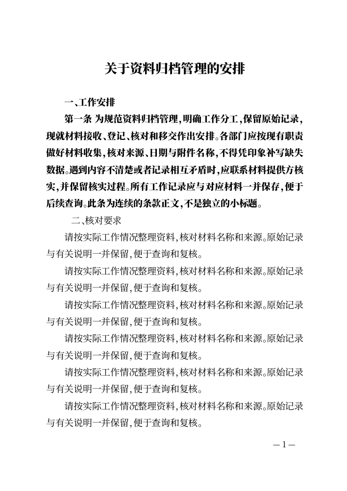
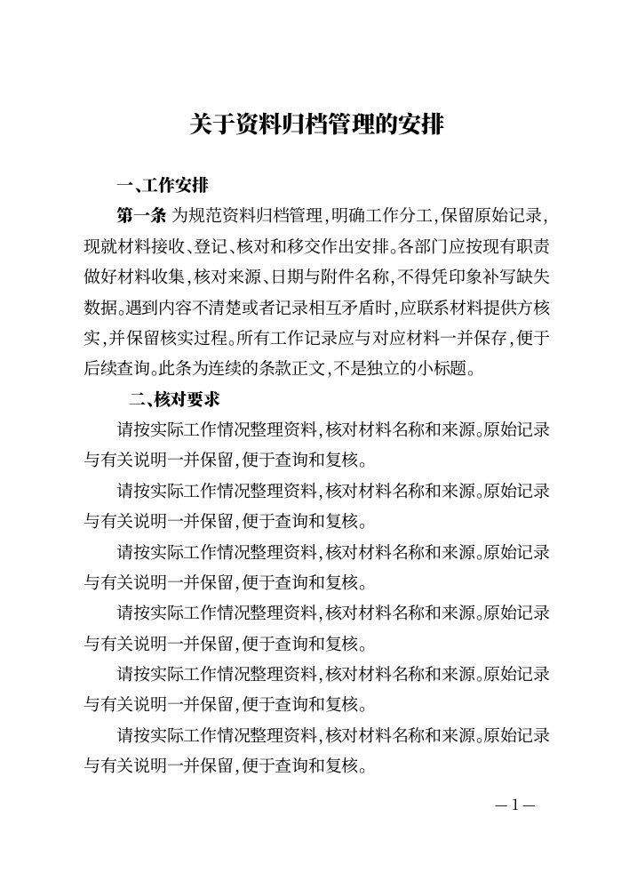
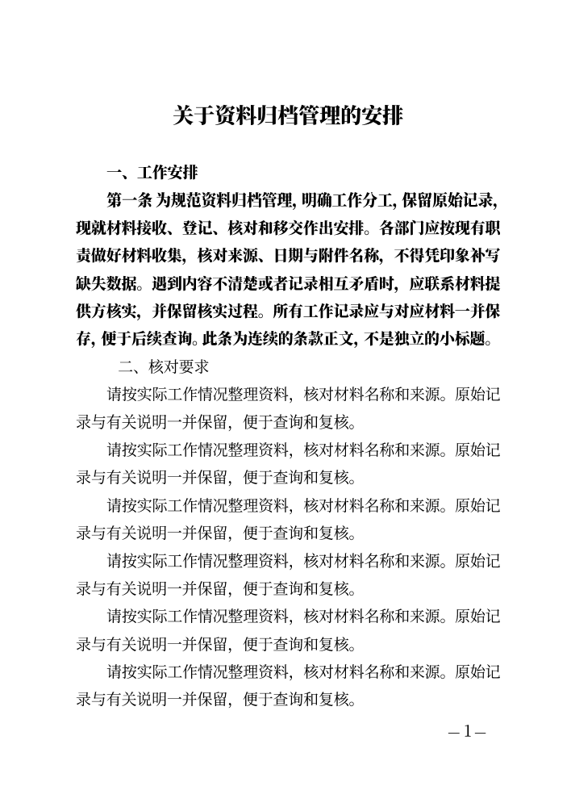
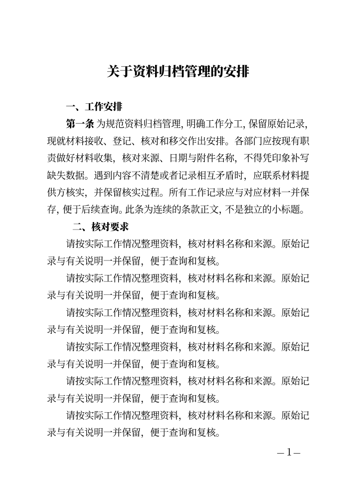
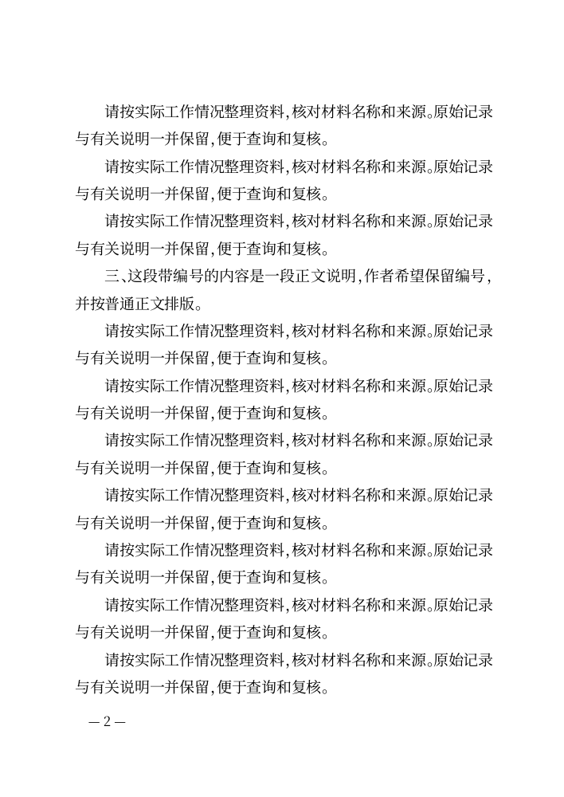
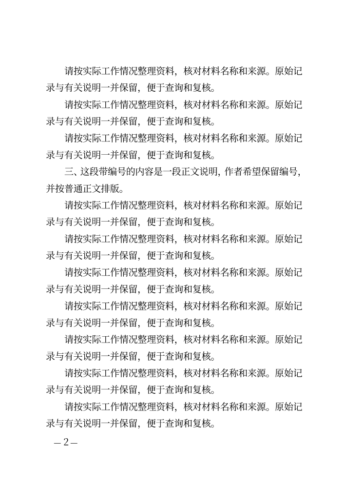

# CEO-003：条款正文、编号标题与作者纠正

> 2026-10-22 更新：本文的高级副本路径保留作历史验证；普通表格/段落调整的接受结论已被用户撤回。最新同稿就地实现与真实验收见[同稿工作区回应](INLINE-WORKSPACE-RESPONSE.md)。

日期：2026-10-21。固定合成稿走查，未使用真实用户正文；实现与验证完成后通过 PR 交付，待 CEO 评价。

## 先复现实际结果

以下三类原文放在同一份三步填写稿中；完整合成材料见 [fixture](../scripts/fixtures/writer-structure.mjs)。旧版的实际 Word/PDF 已下载、解析并用隐藏 Word 打开，不只看模型结果。

```text
一、工作安排
第一条 为规范资料归档管理，明确工作分工，保留原始记录，现就材料接收、登记、核对和移交作出安排。各部门应按现有职责做好材料收集，核对来源、日期与附件名称，不得凭印象补写缺失数据。遇到内容不清楚或者记录相互矛盾时，应联系材料提供方核实，并保留核实过程。所有工作记录应与对应材料一并保存，便于后续查询。此条为连续的条款正文，不是独立的小标题。
   二、核对要求
```

第三行开头是原文的三个空格。

| 材料 | 修改前实际识别与输出 | 修改后实际识别与输出 |
| --- | --- | --- |
| 短独立标题 | heading，标题字体，保持与下段连排 | 保留原行为 |
| 带长正文的“第一条……” | heading，整段标题字体，与下段连排 | article：仅条号沿用强调，条文内容使用正文角色字体，不按标题连排 |
| 前导空格的编号标题 | body，普通正文字体 | heading，标题字体；原来的空格和文字保留 |

在当前内置备用字体环境，Word 实际内嵌的标题/正文字体分别为 Noto Serif SC Black / Noto Serif SC。模型使用的逻辑角色为黑体/仿宋，不将备用字体说成指定字体合规证明。独立核验也读取实际 PDF 字体：修改前长条款字体不同于正文、带空格标题与正文同字体；修改后长条款正文与普通正文同字体，编号标题则使用标题字体。

## 最小改动

三步填写仍使用不要求选择文种的 plain 流程。识别时忽略前后空白，不删除源文的空格；段首“第…条”作为条款正文。泛型条款也不会因为自动层次编号再加上一个标题序号。其他显式文种的既有识别分支、rules 条文连续编号维持原样。

自动识别仍基于常见编号，不宣称能准确理解任意句子的作者意图。另用下面这一段验证作者纠正：

```text
三、这段带编号的内容是一段正文说明，作者希望保留编号，并按普通正文排版。
```

它会先按编号识别为标题；作者可以展开正文旁“需要表格或调整段落？”，下载填写草稿，在已有高级编辑副本中选择这段，把“当前段落”设为“正文”。实际保存、重开、Word/PDF 均保留原文字和编号，输出改为正文样式。没有要求改正文迎合规则，也没有增加字体/行距参数或新富文本系统。

纠正复用 CEO-002 的单向副本路径：需要下载后选入文件，高级副本的修改不会同步回原三步填写。原始填写稿保持可恢复，不承诺双向无损转换。这个成本在操作前说明；本轮没有新建一套段落同步模型。

## 实际页面对照

以下是实际文件渲染页。完整六份 PDF（旧版直接 PDF/Word 转 PDF、新版直接 PDF/Word 转 PDF、纠正后直接 PDF/Word 转 PDF）各 3 页，已检查全部 18 页。这里保留代表页进入 Git，避免证据只存在被忽略的本机目录中。

| 旧版直接 PDF，第 1 页 | 修改后直接 PDF，第 1 页 |
| --- | --- |
|  |  |

| 旧版 Word 16.0 渲染，第 1 页 | 修改后 Word 16.0 渲染，第 1 页 |
| --- | --- |
|  |  |

| 作者将编号段改为正文后的直接 PDF，第 2 页 | 同一纠正后 Word 渲染，第 2 页 |
| --- | --- |
|  |  |

## 验证与范围

- 真实 Go 服务 + Wasm；Chrome 155、Firefox 157、WebKit 27.2 各 11 项，共 33/33。覆盖三类识别、源文/空格/编号不变、作者纠正、实际 Word/PDF、重开保留意图、原填写稿可恢复。
- 独立解析 Word 段落文字、rFonts 与 keepNext，以及 PDF 实际字体，确认结构变化。六类页面均检查，未见重叠、裁切或因本轮改动产生的多余空白页。不承诺跨机器分页一致。
- 新增 Go 用例覆盖中文/阿拉伯条号、前导普通/全角空格与 Tab、各级标题、正文中的条号引用、开启自动编号时不额外编号、作者纠正的非破坏性；`go test ./...` 与 `go vet ./...` 全量通过。
- 已有加表格路径三引擎 45/45、Node 模型/库/确认 19/19、最终 Chrome 首次填写/重开/离线导出 16/16 通过，避免纠正说明扩展破坏已有路径。最终构建的 UI 源码和字体已逐字节核对。

本地详细结果在 `build/qa/ceo-003/`，测试与核验脚本分别为 `test-writer-structure.mjs`、`verify-writer-structure-outputs.py`，验证构建为 `ceo-003-web`；旧版基线使用保留的 `ceo-002-web`。这些目录不作为其他机器的先决条件，关键事实与代表页已在本文件和 fixture 中保留。

手机尺寸仍暂缓，WebKit 是测试引擎而非真机 Safari。没有恢复必选文种、增加云端处理或公开部署。本任务叠加于 PR #3，不把既有三份 PR 的成果当作本轮新增。
