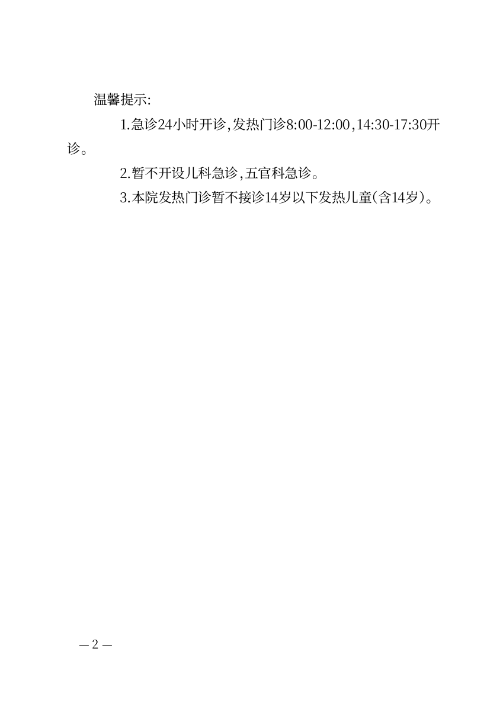

# 医院通知：少一个无助候选，看懂现有空行整理

2026-10-21；CEO-004后续P2，来源main8003bc6、CEO文件eb1e4888。继续同一分支与PR5，不增加医院模板、文种或新开关。

## 先验证已有能力

使用CEO指定[医院公开原文](https://www.zssyzqyy.cn/article/16124)做本地历史重做。提取18个HTML正文段落及原始缩进，标题/正文共503个非空白字符；网站发布日期及发布人不作为正文署名或成文日期。保留全部停诊、补班映射和三项例外，不补造事实，不发布当前就诊指引。

基线实际证明两个不同事实：说明性“根据……结合……安排如下：”确被列为收文对象候选；已有“按空行分段，合并段内硬换行”却已经足以整理本材料，完整保留18段、缩进与顺序。因此没有另加空行功能。旧构建用既有选项即可把这份复制稿从3页整理为2页；本轮不将它冒称新分页能力。

## 最小改进与实际路径

- 收文候选改为保守的称呼/机构对象，排除说明性前言、提示/如下和完整叙述句。本材料只显示标题候选，前言完整留在正文，不再需要作者拒绝错误猜测。各部门、尊敬的患者及家属、具名机构等冒号对象仍可出现；不是所有冒号句都排除，也不承诺任意对象识别准确。
- 原有复选框现在明确写“去除段间空行，合并段内硬换行”，说明仅在空行代表段落边界时选择、先看结果、取消勾选可还原。默认仍不选，不静默删空行；原始材料始终保留并可原样下载。
- 从整篇粘贴开始，只确认标题，明确选择上述现有选项，预览后采用，再导出完整Word/PDF。医院日期/署名保持空白；不因网页日期就补2026-09-09。输入中每个非空HTML段落仍是一段，数字和业务顺序未变。

## 实际文件与完整页组

三浏览器Chrome155/Firefox157/WebKit27.2各11项，共33/33，包括默认不选、完整原文、整理/取消恢复、原文下载、刷新与实际Word/PDF/TXT。Node46/46；原有两份材料三浏览器109/109通过。生产改动只有候选逻辑与已有选项文案，没有改Go生成、文档字体或分页；文案字形已检查，无字体资产变化。

基线按复制原样、基线用已有整理选项、最终三浏览器共5组15份实际Word/PDF/TXT独立核验：18个非空正文段落、503字符、顺序和数字全相符。5份PDF共11页文本检查；整理后的三条重要例外都在第2页，原样基线的年龄限制独居第3页。没有以字符存在代替阅读位置检查。

隐藏Microsoft Word16.0实际打开Chrome基线原样、基线已有整理、最终稿，分别3/2/2页，当前文件哈希与被打开文件一致。最终与基线已有整理的Word字节相同，证明并未偷偷改变版式；去重后原样/整理的Word与直接PDF共10页全部查看，没有裁切、叠字或丢失例外。最终2页仍须作为完整页组交付：第1页的“急诊照常”不构成完整限制，第2页集中保留三项例外，未把它们移到首页或强塞一页。

[原样基线末页](evidence/ceo-hospital/copied-page3.png)、[整理后第1页](evidence/ceo-hospital/tidied-page1.png)、[整理后第2页](evidence/ceo-hospital/tidied-page2.png)、[Word第2页](evidence/ceo-hospital/word-page2.png)。

[浏览器基线](evidence/ceo-hospital/baseline.json)、[当前三浏览器](evidence/ceo-hospital/browser-checks.json)、[实际文件与源码哈希](evidence/ceo-hospital/verified.json)、[隐藏Word记录](evidence/ceo-hospital/word-render.json)随Git保存。脚本为`test-writer-hospital-material.mjs`及`verify-writer-hospital-material.py`，当前构建`build/qa/ceo-hospital-web`。本轮是实施方完整UI与实际文件验证，不冒称新的首次使用者成功率或跨机器版式保证。

该选项依赖空行代表段落边界；含有意段内硬换行的材料应先核对预览，不自动推定所有空行可删。完整页组阅读成本仍存在，不能将2页本身定义为缺陷或将本轮结果当作真实患者行为证据。复合通知的关系表达继续用已有复杂出口另验，不由本题替代。
