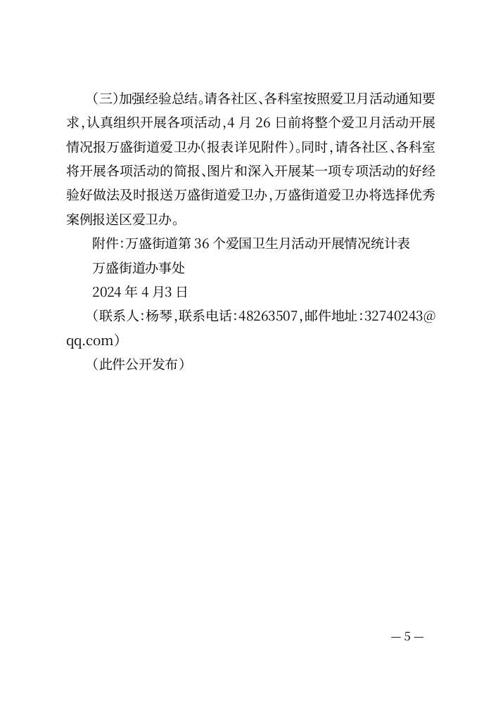
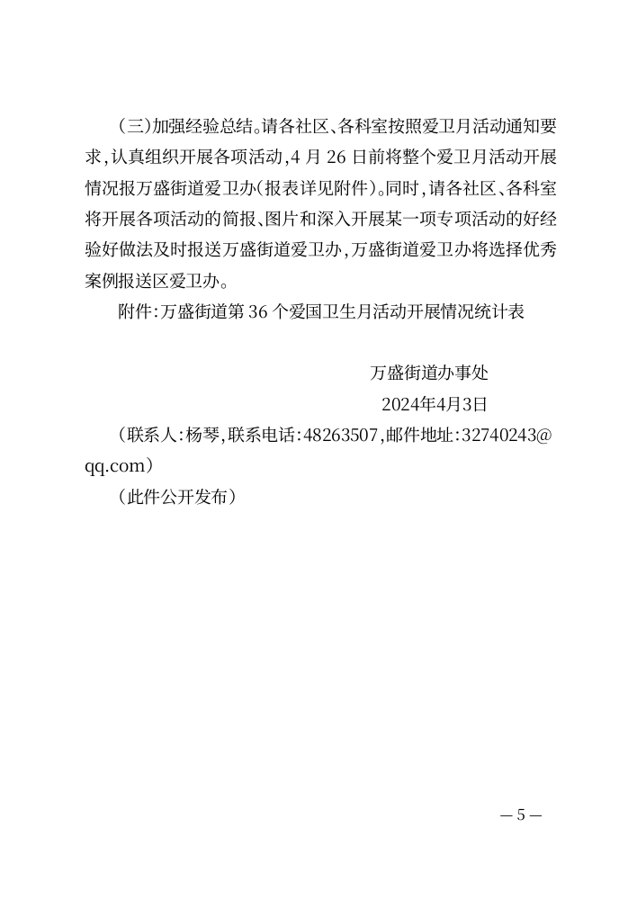
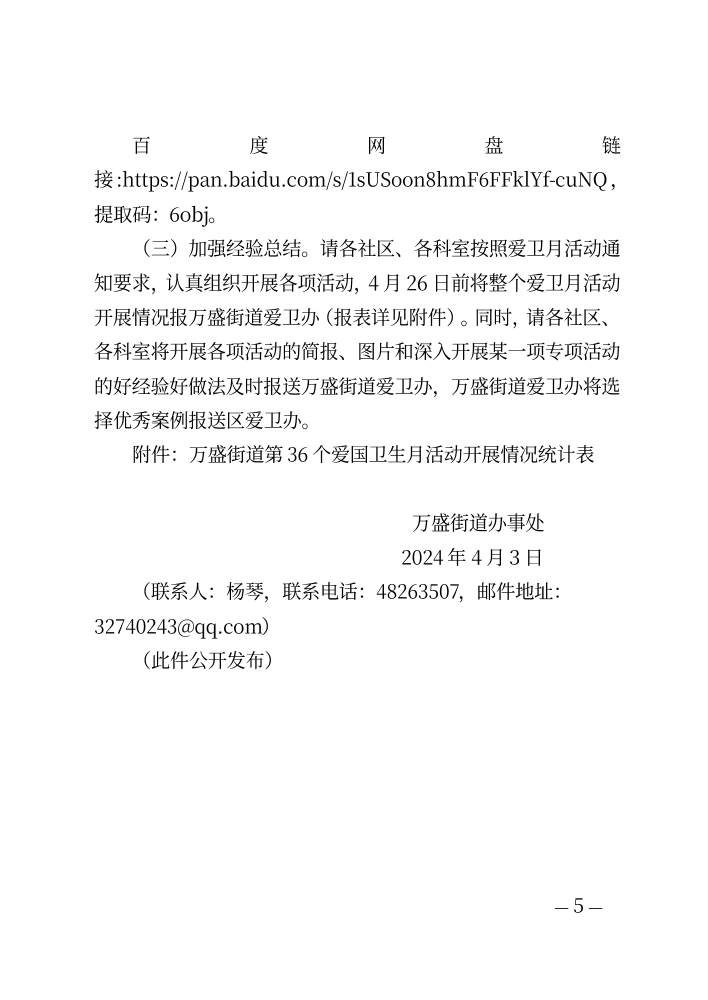

# CEO-004 后续：落款之后的附注仍在原位置

2026-10-21。任务来源：CEO-QUESTIONS blob `67cea0e925aa8228db655d3d88f6fbbd8ab0621c`，相关提交 `66ba3e5e674023c2ff0b61b2ad5ecd6d267f5015`。短通告已获CEO独立纯界面复验；本轮继续修订同一PR #5，处理街道综合办长通知的实际边界。

## 当前路径与最小改进

使用[官方通知](https://ws.cq.gov.cn/jz/wsjd_70058/zwgk_70039/fdzdgknr_70042/lzyj_70043/zcwj_70044/202404/t20240415_13131023.html)的完整行政文稿，从31个非空段落开始，不先拆字段，不移动署名后的联系人、公开发布说明；网页导航、发布日期和下载入口不作为正文。完整材料见[fixture](../scripts/fixtures/writer-postscript-notice.mjs)，只作历史本地复现，附件仅保留原名称，未下载、生成或补造附件。

已交付版本38183b0的实际基线只提出标题与收文对象。日期含单位间空格且不是末行，署名/日期/附注因此都留在正文；可以保全文字，但不能便捷表达文末结构。基线Word/PDF/TXT已实际下载，署名与日期确实按正文左缩进排版。

本轮在原有整篇核对中，允许作者确认非末尾的完整日期及其前署名，并明确选择“后面的内容作为落款后附注”。所有用途仍默认不采用。日期位置不唯一时，先选择原文行号，再逐项确认；切换位置会撤销旧的落款用途确认。采用非末尾日期须同时确认后续附注，避免把它们静默搬到署名前；否则保留在正文。附件标识行不会并入署名候选。

采用后正文、署名、日期、附注各有明确位置；附注可在正文内容页的可选折叠字段中继续编辑，摘要说明“排在日期后”。原始材料保持完整可恢复，取消不替换。无需下载草稿副本或进入高级工作区，也不要求改动原文字序迎合识别。日期格式中的空白统一呈现，年月日数字不改；附注按原段落顺序保留，不合并为机关名。

含附注的便携草稿采用v3，旧v1/v2补空字段继续读取；旧应用会明确拒绝新版本，避免默默丢附注。附注上限4000字符，整篇候选超限阻止采用；手动超长粘贴在启动前后均明确拒绝，不截断。原文及附注不进入常用信息。沿用既有`note`模型角色与本地引擎，不改Go的通用分页或原件保护。

## 本轮证据

| 检查 | 当前结果 |
| --- | --- |
| 完整长通知主任务，Chrome155 / Firefox157 / WebKit27.2 | 42/42；默认不采用、明确附注、取消、真实文件、模拟附注更正、原稿恢复、新存储导入v3 |
| 新字段启动保护及多日期选择 | 21/21；启动前附注编辑/刷新/恢复，前后超长粘贴拒绝，切换日期不复用旧确认 |
| 模型/资料整理/库/提醒依赖 | Node37/37；含附件边界、日期空格、v1/v2/v3校验、附注模型顺序及提醒行定位 |
| 独立解析真实文件 | 基线1组、新版3浏览器×原稿/模拟共6组，Word精确31段顺序，PDF/TXT全文精确一致（忽略空白和生成页码）；新日期只统一格式 |
| 既有可靠性与普通操作 | 启动异常33/33，最终Chrome首次流程16/16，跨标签恢复、旧缓存升级通过 |
| 短通告回归 | 39/39，联合署名、成文日期、复制改期与原稿恢复继续成立 |
| 既有长稿提醒回归 | 当前构建66/66，重复表达定位、说明/依据、无关修改保留确认、元数据与CRLF来源继续成立 |
| 既有表格出口回归 | 当前构建45/45，草稿导入、实际表格导出、取消/撤销和恢复继续成立 |
| 共用引擎 | 当前工作树`go test ./...`与`go vet ./...`通过 |
| 既有单向副本 | 当前v3草稿实际经过browser-api原生导入，两个附注段落保留；普通任务本身未走这个出口 |

独立PDF核验采用内容流顺序：几何排序提取器会把悬挂开引号/括号与前一字交换，而内容流全文与Word均吻合。没有因此放宽、删除或替换正文字符。脚本为[文件核验](../scripts/verify-writer-postscript.py)、[主路径](../scripts/test-writer-postscript.mjs)、[恢复/多日期](../scripts/test-writer-postscript-recovery.mjs)和[模型边界](../scripts/test-writer-postscript-model.mjs)。

本机Microsoft Word16.0隐藏打开基线、整理、模拟三份文件，均5页；直接PDF同样各5页。全部30个代表实际页面已查看，未见裁切、叠字或多余空白页，末页的署名/日期右对齐，附注在后并独立左排。Word与PDF行距、断行存在差异，网址在Word中仍有既有字距拉伸；未证明链接失效，也不把这次有限核验包装成全局版式合规或跨机器保证。

## 实际末页与界面

[核对中的明确选择](evidence/ceo-004-postscript/proposal.png)、[摘要](evidence/ceo-004-postscript/summary-final.png)、[可继续编辑的附注](evidence/ceo-004-postscript/notes-field-final.png)、[模拟更正末页](evidence/ceo-004-postscript/simulated-pdf-5.png)。

本轮是这份公开长通知的具体任务证据，不是任意材料的署名识别准确率。候选仍需作者确认；未加入云端AI、必选文种或完整编辑器，不生成事实、不上传文稿。手机/Safari真机、物理打印与医院表格体验不在本轮已验证范围。完整本机结果与源码哈希在忽略目录`build/qa/ceo-004-postscript/`；不能假定其他机器拥有该目录，因此代表页和结论随Git保存。
