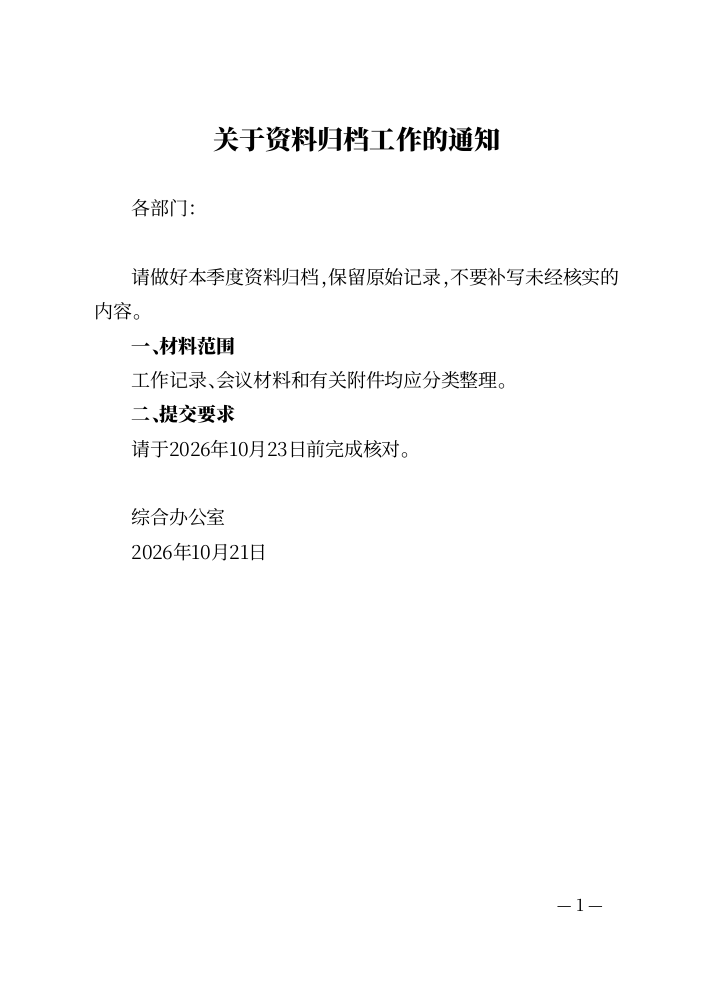
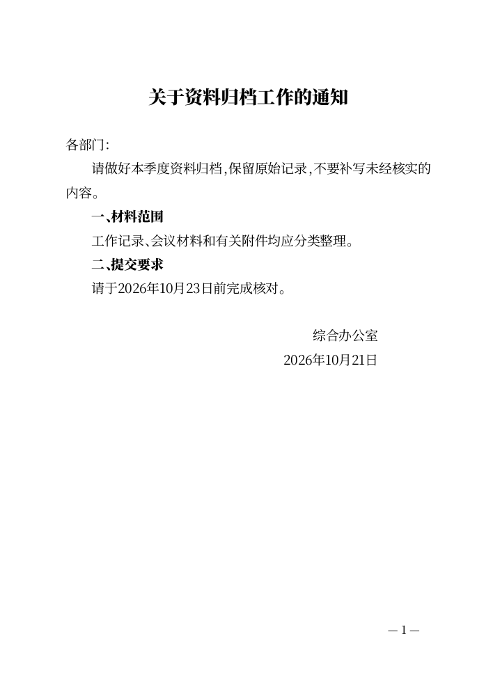
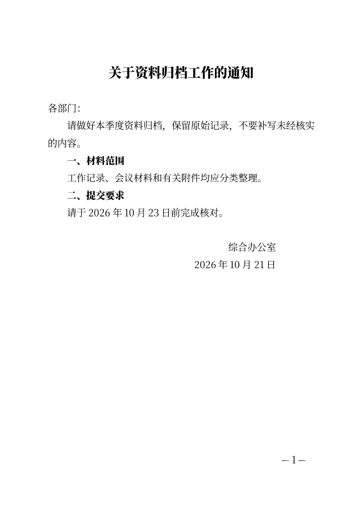
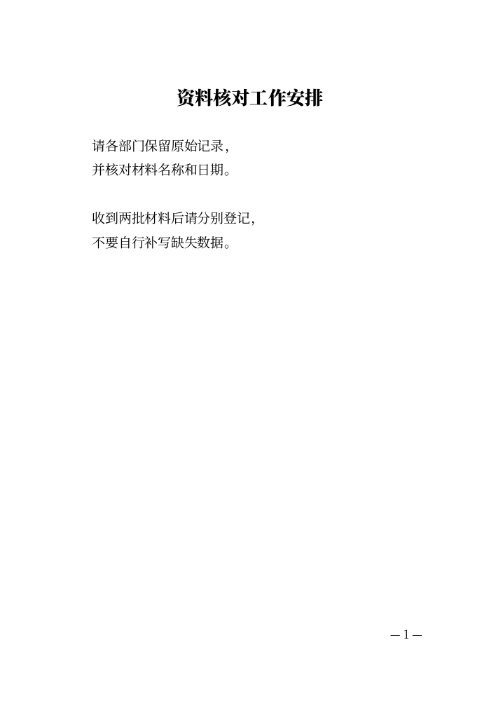
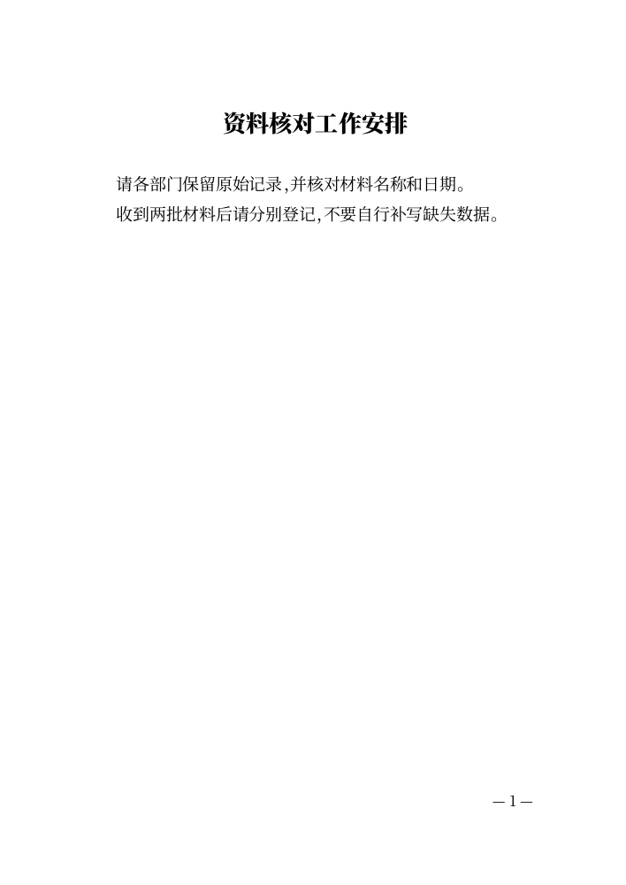
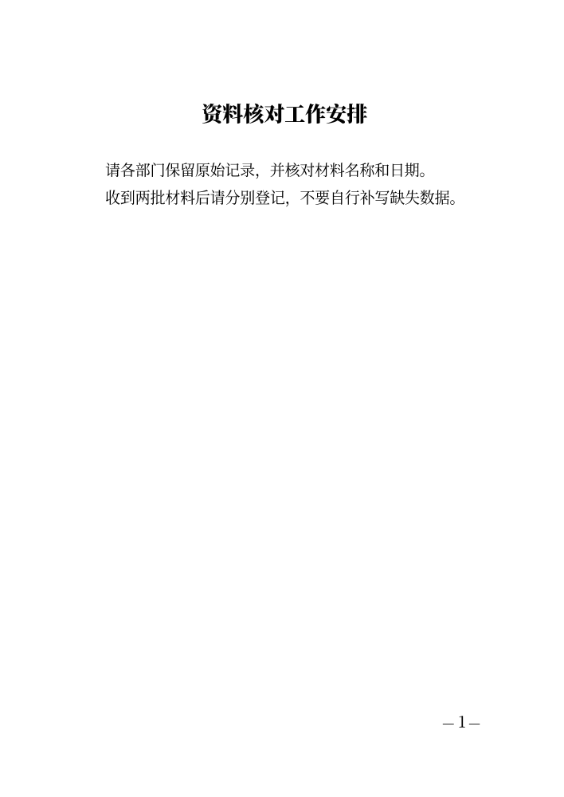

# CEO-004：整篇文字材料到实际成品

后续真实长通知的落款后附注问题及当前修订证据见[同一PR的后续回应](CEO-004-POSTSCRIPT-RESPONSE.md)。下文保留首轮短材料验收来源，不能替代后续版本证据。

日期：2026-10-21。来源为 CEO-QUESTIONS 初始任务 blob `7a3c37673344f7f18fb17ad3b36098cadb909f1b`、PR #4 评价 blob `271d71c7c3eb15a143a561b0e3d63475903a81af`，以及真实通告体验 blob `fbd134667f16841b59f5398d39c13a5a6de3a304`（main commit `970327d75011252bf32397918023ebca9a1b88d3`）。本轮叠加于 PR #4 的 aa76db1；此前 PR 尚未合并，本文不是主线能力声明。

## 先走现有路径

从 [fixture](../scripts/fixtures/writer-materials.mjs) 的完整原文开始，未提前拆成填写字段。使用实际 Go webserve 和 Chrome，把原文首行放标题、余文放正文，再尝试按原流程完成。

| 合成材料 | 原流程可行之处与断点 | 本轮最小补足后 |
| --- | --- | --- |
| 通知：标题、各部门、正文、小标题、综合办公室、2026年10月21日；正文另有23日的期限 | 可以留在三步填写，但需手动拆出标题、收文对象、落款、日期，从正文去重并转填日期。余文直接粘贴时，收文对象按正文缩进、落款没有右对齐 | 整篇粘贴，确认4个候选用途；独立要素只移入一次，正文期限23日和落款日期21日分别保留 |
| 工作安排：标题、两个空行分组，每组两行硬换行 | 可以完成，但直接粘贴得到4个正文段；需作者人工合并为2段。保存的是整理后字段，没有整篇原文入口 | 确认标题后主动选择合并硬换行，得到2段；原文仍保留空行与原始换行 |

两条基线均未进入高级编辑，无需段落纠正。这里记录逻辑准备操作和实际文件差异，未测量人类操作时间，也没有真实用户完成率。基线 Word XML 独立验证收文缩进、落款对齐和段落数量，下载按钮并非验收终点。

## 最终行为

基本信息页增加一个默认折叠的“已有一篇文字稿？”入口，三步流程不变。整篇输入先暂存；点击核对后，界面展示候选原句、原文行号和整理后的正文。标题、收文对象、落款、完整日期均由作者勾选，默认不采用；未选内容留在正文。相对日期、无效日期不推断，冲突用途不能采用。

合并段内硬换行是独立选项，预览后再确认。编号标题开头的整组保留原换行；相邻数字/英文 token 之间保留分隔，避免把 `1` 换行 `00` 静默变成 `100`。这不是通用语义识别器，列表、聊天记录及复杂材料仍须核对结果；不确定时不选合并，或取消后手工整理。

采用后替换当前填写稿，沿用既有安全归档与撤销路径；原稿归档失败、容量已满或存储失败时，当前文档和待整理输入保留，弹窗就地说明。整理前的完整文字单独保留，可查看和下载；只是统一换行为 LF，不恢复外部格式或文件字节。原文及尚未采用的另一份材料不进入成品、不改变已有内容确认。作者仍在三步填写页核对并下载最终 Word/PDF/TXT，无需经过高级副本。本轮两份样例：手工拆字段0次、段落类型纠正0次、离开填写流程0次；用途确认仍需作者完成。

含原文的便携草稿明确使用 v2，同时保存已用原文和未采用输入；旧 v1 草稿补空原文字段后继续可用，旧版应用不能默默丢弃 v2 原文。读取上限为2 MiB，各字段原有长度限制不放宽；源材料最多100000字符，超长粘贴明确拒绝。普通不含原文的稿仍可用v1。所有处理均在浏览器本地，没有上传或云端 AI。

## 真实验收

Windows 桌面，Chrome 155、Firefox 157、Playwright WebKit 27.2；实际 Go 服务、Go/Wasm、独立无头上下文。用完整原文作为唯一材料输入，经历启动前输入/刷新、核对、取消、明确采用、原文下载、实际导出、保存重开。每个导出时另暂存含9071的新材料，验证它没有混入成品。

| 验证 | 本轮结果 |
| --- | --- |
| 三浏览器 × 两份完整材料 | 109/109；含默认不提取、主动合并、取消保留、满库拒绝替换、原文恢复；脚本 `test-writer-materials-browser.mjs` |
| 新存储中实际导入下载草稿 | 两份v2，全部字段与两个原文状态一致，独立副本ID；`test-writer-materials-restore.mjs` |
| 独立检查下载内容 | 六组Word段落顺序/文字精确一致；PDF/TXT精确一致（排除生成页码）；下载原文精确一致，9071未混入；`verify-writer-materials-outputs.py` |
| 模型、资料整理、库、确认依赖 | Node 31/31；含v1迁移/v2严格校验、相对日期不猜、冲突选择、最坏转义体积、原文不影响内容确认、联合署名及条款后的提醒定位 |
| 已有可靠性回归 | 启动异常33/33；跨标签恢复和旧缓存升级通过；最终构建 Chrome 首次填写/重开/离线导出16/16 |
| 已有复杂出口回归 | 当前稿加表格，三浏览器45/45 |
| 实际页面 | 两份新版直接PDF和隐藏Word16.0均为1页；下方前后页面已查看，无裁切、重叠、多余空白页 |

本轮未修改后端文档生成/分页源码或文档字体，因此不重复将上轮Go全量测试写成本轮证据。新增界面字形更新了UI字体子集，不影响文档字体。浏览器溢出输入用合成事件负载测试，未触碰系统剪贴板或用户前台。构建来源、真实文件SHA256及每项检查保存在本机 `build/qa/ceo-004/verified-outputs.json` 和相邻结果记录；这些忽略目录不是其他机器可取得的附件，以下代表页随Git保存。

## 可审阅的实际页面

通知：直接粘贴余文的基线、确认整理后的直接PDF、本机Word打开后导出的PDF。落款从正文移到独立右对齐位置；两个日期保持各自用途。

硬换行材料：基线的四个正文段，整理后成为作者明确选择的两个段落；原文可从草稿或原文下载恢复。

[通知核对界面](evidence/ceo-004/notice-proposal.png)、[硬换行核对界面](evidence/ceo-004/wrapped-proposal.png)。

## 实际边界与后续

这是两份合成材料的完整任务验收，不推广为任意文章的自动拆分准确率。未知结构保留在正文，作者可取消或继续调整填写内容；原文不因整理被覆盖。高级副本仍只用于偶发复杂任务，本轮普通材料不需要它。WebKit不是macOS/iOS Safari真机，手机尺寸未验收；Word可能随机器重排，内置Noto替代字体不构成指定字体合规保证。未合并、未公开部署；集成基线变化后仍须核对原有路径及v1/v2草稿兼容。

## CEO 真实通告发现：字段状态与联合署名

交付前再次拉取CEO记录，发现上述两份合成材料没有覆盖其新增真实断点，因此继续同一CEO-004，未以旧验收关闭任务。CEO已实际体验[济源公安官网交通管制通告](https://gaj.jiyuan.gov.cn/gonggao/gonggao/gsgg/t942912.html)：两署名和日期放在正文时没有丢失，但摘要“未填写”会让人误解文档缺少它们；单行落款入口也没有说明联合署名路径。

最小修订：摘要改为“未单独填写；如已在正文中保留，无需重复添加”，只陈述字段状态，不推断文档缺项。落款和常用落款支持逐行联合署名，明确说明正文与独立字段的关系。整篇核对能显示原顺序的尾部署名组和原文行号，仍必须作者选择；采用后各署名单独右对齐，日期在其后。定位逻辑同时支持第二署名行，并补齐CEO-003的article段落来源映射，避免条款之后的提醒错位。

使用[完整公开行政通告fixture](../scripts/fixtures/writer-joint-notice.mjs)，只做历史本地复现，无印章或对外发布；成文日期为2024-05-15，网页发布日期为2024-05-16，两者不混用。新实测包括：

- 保留在正文的自然路径：摘要清楚说明字段未单独填写，不要求重复补填；实际文件两署名及原日期各出现一次。
- 整篇整理路径：明确确认标题、两行联合落款、日期，并选择按空行分段（将网页的段落分隔空行从成品空白段中移除，原文仍可恢复）。全程留在填写页；正文的管制路段、时段和特种车辆例外不改，两署名与日期移到独立段落，原顺序保留。
- 用界面复制当前稿，标题明确标为“模拟日期更正”，仅将独立日期改为16日；其余正文、署名、原始材料保持一致。随后从“我的文档”恢复15日原稿，刷新后仍正确。

Chrome、Firefox、WebKit共39/39，九组Word/PDF/TXT独立核验内容、顺序、无重复。每份直接PDF为2页；Chrome的正文保留/整理/模拟三份均由隐藏Word16.0实际打开并转PDF，均2页。本轮页面检查发现网页空行直接作为空白段时可能把标题与下段隔开，因此最终整理路径明确采用已有分段选项；没有静默合并原文或修改通用分页规则。最终十二个代表性实际页面已查看，整理后的编号标题与下段相随，联合署名在文末同页，未见裁切/重叠/多余空白页。全部成品文字逐项核验不依赖这个视觉结论。

[三种路径的成品第2页](evidence/ceo-004/joint-page2-comparison.png)、[整理后直接PDF第1页](evidence/ceo-004/joint-arranged-pdf-1.png)、[整理后直接PDF第2页](evidence/ceo-004/joint-arranged-pdf-2.png)、[整理后Word第2页](evidence/ceo-004/joint-arranged-word-2.png)、[最终摘要界面](evidence/ceo-004/joint-summary.png)。完整本机输出和环境记录在 `build/qa/ceo-004-joint/`，独立核验脚本为 `verify-writer-joint-notice.py`。这仍非真实用户统计、任意联合发文识别准确率或法定版式证明。CEO提到的医院表格体验尚无结论，本轮未冒称通过。
