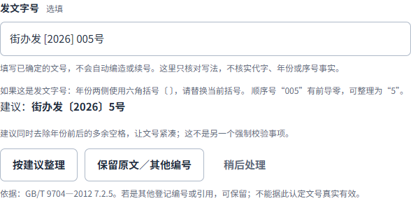
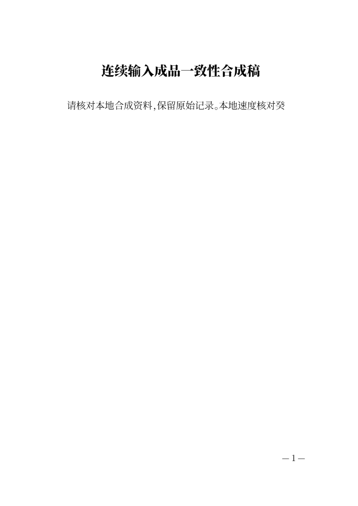

# CEO-005/006：减少预览等待，文号填写时即可核对

日期2026-10-21。来源为CEO-QUESTIONS初始blob `96fdef6b0578e51c43b5da568e71abb0cb86b2cd`及最新`8fb5af92fe99388d0a72ee0795f59e3411d90790`的红头反馈；继续同一分支与PR #5。先以已交付7ec69ca（f1实现）测基线，没有把CEO旧e12构建的1771ms观察当成当前版本数据，也不要求普通使用者提交技术报告。

## CEO-005：先测量，再减少等待

基线证实固定650ms等待之外，每次更新还重新创建PDF.js工作线程，检查与PDF解码串行。新实现按最后一次编辑计算120ms安静间隔，复用调用方PDFWorker，异步提前准备实际引擎，将检查与解码并行。各耗时阶段之间及canvas提交前检查内容版本；旧处理完成后只继续最新内容。更新期间输入、保存保持可用，格式化导出仍等待最新完整PDF与检查，不用近似画面代替成品。

当前本机环境：Windows内核10.0.26200，Intel i5-10400 2.90GHz，12逻辑CPU；无头桌面1440×1000，Chrome155、Firefox157、WebKit27.2。每浏览器短稿20次、长正文8次、新存储首次3次、缓存重开1次；基线和最终各96条。短稿约100字，长正文来自已有街道通知；当前页为第1页。另测含全部填写字段与附注的街道旧稿，见下文。

指标分开记录：同步合成input事件处理；输入结束到新canvas提交后两帧作为可见更新近似；整份实际PDF排版与检查完成。它不是物理按键到屏幕的端到端测量，也不含人工核对提醒的时间。“主表单ready”不是启动保护的开始，启动前输入另有回归证据。

| 浏览器 | 短稿基线中位 / P95 | 最终短稿中位 / P95 / 最长 | 最终长正文中位 / P95 |
| --- | --- | --- | --- |
| Chrome | 1198 / 1691ms | 430 / 480 / 497ms | 772 / 1014ms |
| Firefox | 1213 / 1311ms | 513 / 659 / 706ms | 805 / 896ms |
| WebKit | 1408 / 1880ms | 635 / 729 / 772ms | 939 / 998ms |

上述是输入后当前页可见更新。最终短稿输入处理最大分别0.9/1/1ms；真实编辑注入时也验证可保存，没有把预览等待误称为键盘被锁死。新存储首次输入后可见更新，中位/最长为Chrome833/945ms、Firefox701/821ms、WebKit783/969ms（各3次）。缓存重开从导航到可见分别658/1033/1004ms（各1次，不能据此推断稳定分布）。整份排版/检查就绪时间和每个后台方法耗时均在原始行中，未用脚本总耗时代替响应。

**完整街道旧稿边界。** 使用同一已验收街道通知的完整标题、主送、正文、署名、2024-04-03日期与两段附注，标题标记为测速副本，只在正文追加7字测量标记。Chrome8次暖态编辑：基线中位2254ms、P95/最长4081ms，最终中位846.5ms、P95/最长1177ms。完整旧稿初次/缓存打开各仅1次，基线3710/1902ms，最终2140/1223ms，不能据此推断稳定分布。此前加入红头反馈前的同口径观察为暖态中位1181ms、最长2260ms，初次/缓存4689/3081ms（比基线慢）；该次原始行也保留，没有因最终变快而丢弃冷准备慢样本。原因未定，不用短稿数字掩盖长稿边界，也不承诺长稿秒开。

本轮最终短稿样本达到常用桌面约1秒的目标观察值，不是所有设备上界。较早探索中同机WebKit曾有1.56秒短稿慢样本，最终长稿也仍有超过1秒的样本，需保留独立复验空间。用户实际设备和等待秒数仍未知，不声称已经解释了其所有慢体验。

[基线Chrome原始行](evidence/ceo-005-006/baseline-chrome.json)、[基线Firefox/WebKit](evidence/ceo-005-006/baseline-firefox-webkit.json)、[最终三浏览器原始行](evidence/ceo-005-006/final-three-browsers.json)、[逐浏览器统计](evidence/ceo-005-006/timing-summary.json)、[探索波动摘要](evidence/ceo-005-006/exploratory-summary.json)、[完整旧稿基线](evidence/ceo-005-006/street-baseline.json)、[完整旧稿最终](evidence/ceo-005-006/street-final.json)随Git保存；不含用户稿件正文。中位数取统计中位，P95取向上取整秩；分析脚本为`analyze-writer-preview.py`。本机完整QA与版本哈希仍在`build/qa/ceo-005/`。

## CEO-006：字段旁提出具体建议，继续复用同一判断

“街办发 [2026] 005号”输入完整时，即在原字段旁说明年份括号与序号前导零，给出“街办发〔2026〕5号”，不等待排版引擎或最后一步。2026保持为完整年份，没有误报年份格式错误。去除年份前后的多余空格作为紧凑呈现建议，明确不另列强制校验事项。

可以明确按建议整理、保留原文/其他登记编号，或稍后处理；没有静默改写。整理后原输入仍可见，并可撤销本次整理。进入正文前若未核对，有返回同一字段的轻提示；不设模态弹窗或独立规则中心。空白、登记编号2026-005、正常三位序号105不因位数被误报，也不提供“真实有效/合规认证”。

早期“保留”只在原文、规则、严重程度及Go建议与当前`reference.format`相符时桥接到既有ReviewDecisions；最终对应提醒直接沿用确认。无关标题修改不重复确认，修改序号、撤销保留或原文变动后重新核对；最终取消勾选也同步回字段。保持原有本标签页判断范围，不承诺跨刷新保存确认。撤销整理保留原字符与空格，但不自动恢复编辑前已经失效的判断。

依据：[国家标准公开页](https://openstd.samr.gov.cn/bzgk/std/newGbInfo?hcno=F3CC9BEF482524C895FDA7A08BB4A70E&refer=outter)核实GB/T9704-2012状态；[浦东新区南汇新城镇公开公文处理办法](https://www.pudong.gov.cn/zwgk/zwgk_zfxxgkml_atc_tz/2022/287/46129.html)（五）明确六角括号、序号不编虚位/不加“第”。界面仅就已知完整写法提出建议，不核验机关代字合法性、年份或序号事实。

## 正确性与回归

勾选红头但发文单位为空时，字段旁立即说明“还需填写发文单位”，标明红头必填，并解释填写前不生成红头、不用收文对象或落款代填。填写、清空、取消、重新勾选及重新打开均同步状态；取消只停用红头，保留作者已经填写的单位。缺少单位时仍保护导航，未完成草稿预览保留独立落款，不从它推断红头。正常填写后的实际预览、Word/PDF有相同红头，取消后的成品没有红头。

[填写后的实际PDF](evidence/ceo-005-006/letterhead-on-pdf.png)、[取消后的实际Word](evidence/ceo-005-006/letterhead-off-word.png)。

- 三浏览器连续更新18/18：实际在排版处理及canvas绘制期间注入新输入，保存可用；过期canvas不提交，最后Word/PDF/TXT只含最新“癸”版本。每份仍为完整实际PDF。
- 三浏览器文号路径45/45：原样输入在引擎尚未就绪时提示、稍后处理、保留复用、明确纠正、原字符/空格撤销、序号改变后复核，以及空白/其他编号/正常三位序号。12组实际成品独立核验，Word/PDF文号原字符与空格逐项相符；纠正仅在点击后发生。
- 红头状态三浏览器27/27；新增六组实际成品检查，包括PDF文字和红色字形。连同上面12组，共18组实际成品通过独立核验。
- Node41/41，Go全量test/vet通过；共享语料同时约束字段建议与已有Go纠正。旧长稿提醒66/66、启动33/33、Chrome首次16/16、持久恢复/跨标签/旧缓存升级通过。最后红头改动后重跑启动、首次填写、模型与实际成品核验；Go生成代码未改，测试范围与时点不混称。
- 回归曾暴露提示在失焦时展开会移动“下一步”点击目标，已修复：完整写法同步显示，导航点击期间不重新移动后方按钮；没有为了通过测试放宽下一步断言。新文案UI字形5个码位已补齐，最终显示字符无缺字。
- 隐藏Microsoft Word16.0实际打开最新输入、原样/纠正/撤销文号及红头开/关六份文件，均1页；直接PDF各1页，全部12页已查看，无裁切、叠字或多余空白页。当前同内容导出与已打开的Word文件字节相同。本轮未改文档字体或通用排版；字体替代与跨机器断行边界仍保留。

[保留原样PDF](evidence/ceo-005-006/reference-retained-pdf.png)、[明确纠正PDF](evidence/ceo-005-006/reference-corrected-pdf.png)、[撤销后Word](evidence/ceo-005-006/reference-undone-word.png)。成品中的标题/文号顺序沿用既有plain模式；TXT保留其既有元数据顺序，未为此任务擅自更换。

固定本地服务继续为`http://127.0.0.1:4173`，只在本轮验收后同步资产，后台健康检查/恢复脚本不变。未合并PR、未公开部署、未上传用户文稿；手机、Safari真机、物理打印与医院表格体验未列为完成。
