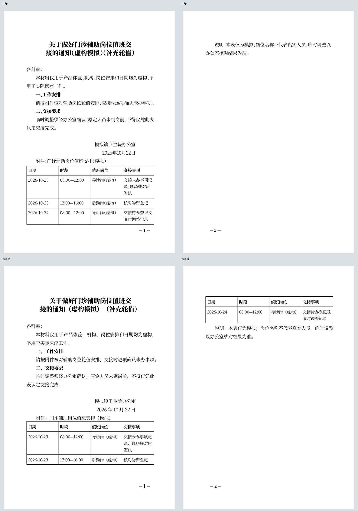

# 岗位任务：基层卫生院办公室的值班交接通知

2026-10-22；回应CEO main deaab3ec 的具体岗位体验方向，仍在同一PR #5。本轮无产品源码变化，未合并或公开部署。

## 岗位、交付与方法

办公室工作人员需要将整篇通知与辅助岗位排班一起整理，在关页后继续补一个班次、细化现有交接事项，交付Word、PDF及可恢复稿。原文的临时调整例外必须保留，不能只证明有表格按钮。

机构、岗位、日期和全部内容为明确标记的虚构模拟，没有真实医务人员或患者信息，不用于实际医疗工作。**这是实施者知情的岗位任务走查，非无历史体验者、真实用户研究或医疗业务规则验收。** 使用Chrome155、1280×720、100%缩放，在实际http://127.0.0.1:4173创建独立浏览器上下文；正常UI粘贴、确认、选择、编辑、保存和下载，没有注入草稿或写入存储，没有操作用户原标签或前台。Impeccable仅用于Operate模式任务观察，未执行正式critique或重做视觉设计。

## 实际完成结果

1. 从[完整虚构材料](evidence/clinic-handover/source.txt)开始，明确确认标题、收文、署名、日期和落款后内容；正文条件、原材料和表后说明保留。
2. 在落款后原位把现有制表符排班确认为3行4列表，尾部“说明”不进入网格；不用重录原两班资料或搬回正文。
3. 保存后关闭自己的标签，新标签继续同一稿。增加2026-10-24上午班次，修改首班交接事项，再给标题加“补充轮值”，保存刷新；表格为4×4，原正文、署名日期和例外说明未变。
4. 正常下载[最终可恢复稿](evidence/clinic-handover/final.gongwen.json)及本机实际Word/PDF。独立核验全部16格、347个非空白字符与顺序；真实草稿与最终结构一致。隐藏Word16.0只读打开，逻辑全文SHA和实际下载源SHA匹配。未发现丢稿、误换选段或交付阻断。

[UI过程与六项核对](evidence/clinic-handover/result.json)、[独立成品及服务指纹](evidence/clinic-handover/verified.json)、[原生Word指纹](evidence/clinic-handover/word-render.json)。实际HTTP引擎响应与本机已验资产相同；没有把服务器哈希扩大成浏览器已加载字节认证。产品实现仍f68f008，本轮无重建或字体/分页调整，不重跑无关全量测试。

## 成品与体验边界

直接PDF两页、原生Word两页，四页全部渲染查看，无裁切、叠字、缺字或表线缺失。**PDF表后说明单独到第二页；Word最后一个班次与说明在第二页，表头正常重复。** 不称单页交付或Word/PDF逐页相同，不能从两个页数相等推导相同版式。两页的完整文件才是本次交付单位，不能只分发第一页。没有为了凑页数删掉尾部条件。

材料确认弹窗首屏底部选项和确认按钮不同时可见；控件自动滚动后可以完成，本轮不声称人工滚动次数或完成耗时。02-original-table截图保留转换后的编辑状态，其“1页”不能作为最终新稿页数证据；最终预览与下载为2页。使用者知情选择了“按段落编辑→添加表格”，不能据此声称首次用户一定能发现转换能力。没有真实中文选词、手机、真机Safari或物理打印新增声明。

本轮支持的具体结论是：已有能力可承接办公室跨次排班修订与完整交付；目前无需以此新增工具或布局工程。后续新岗位任务应有不同业务交付价值，不重复教育回执、采购转换或本题测试来填充工作量。CEO此前选段误设观察已澄清未复现，短屏留白仅保留观察，未作为已确认缺陷修复。保留本地服务，后续按用户反馈及CEO具体取舍继续。

复现：现有已验资产运行在4173，执行node scripts/test-writer-clinic-handover.mjs。输出build/qa/clinic-handover，隐藏Word将final.docx另存final.word.pdf并记录word-render.json，再用scripts/verify-writer-clinic-handover.py核对全文、表格、文件SHA并渲染。页面图片仍须人工检查；脚本不自动声称视觉通过。全部虚构资料可审阅，忽略目录的二进制文件不是其他机器已有的文件。
