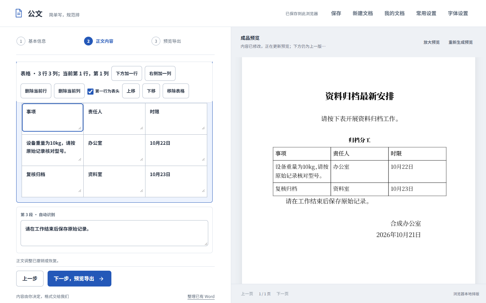
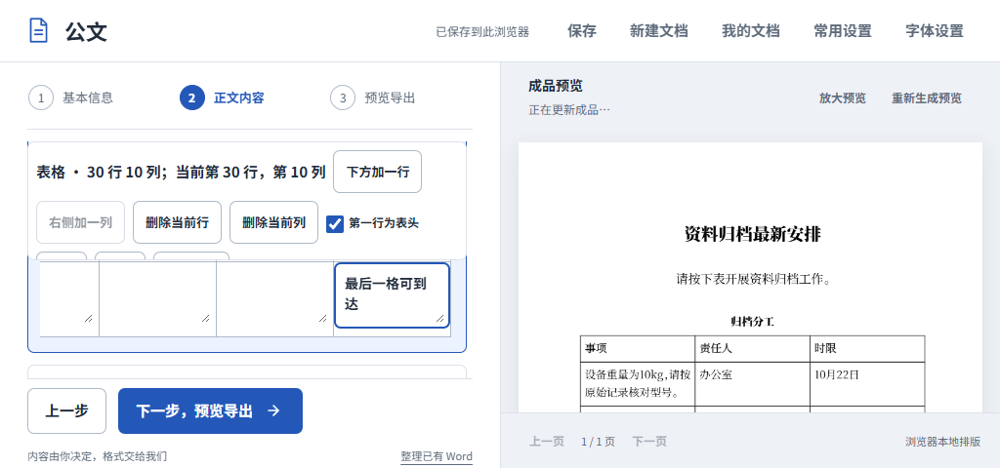

# 正常页同稿编辑、预览收敛与固定工作区

> 后续修订：自然整篇整理后的回执已补齐原位结构编辑与确认转表，结构区组合结束也新增实证修复；最新验收见[落款后回执连续编辑](POSTSCRIPT-WORKSPACE-RESPONSE.md)。本文35b23d9证据保留历史时点。

2026-10-22；承接用户最新纠正及CEO-002/003/005，读取main616b492f、CEO文件a03377cc。沿用codex/ceo-004-materials和PR5，不另开PR、不合并或公开部署。本文对应随本次提交保存的源码哈希，不能与main或历史6fa构建混同。

## 最终行为

- 已有标题、正文、落款的稿件，在正文选中位置后直接添加表格，填写单元格、增删当前行列、调整表头及顺序。取消插入不改变原稿，修改支持撤销/重做。继续跨步骤、保存、刷新和再次打开，仍是原来的稿件；普通操作不下载草稿、不导入文件、不进入advanced。
- 需要整理时再开启“按段落编辑”，就地选择正文、标题、一级至四级标题、条文、署名、日期，拆分/合并及上下移动。对齐提供随类型/左/居中/右/两端，首行缩进随类型/无/两字，段前后随类型/无/半行/一行；这些格式收在展开项内，不提供完整Word参数墙。
- 草稿v4保存结构和同一稿身份，正文文字由结构派生，兼容读取v1–v3。存储失败可下载完整结构应急保存；损坏/矛盾结构保护原始数据，不能悄悄变成纯文字。空白回执表也作为内容保留。判断绑定真实段落或单元格，单元格提醒标出行列并准确聚焦；相关文字/格式变化重新核对，无关修改和保存重开不无故抹掉判断。
- 日期无效或控件输入未完成时，右侧明确说明尚未生成新版，不继续暗示计算中。全部普通填写字段统一处理compositionend；没有最终非组合input也会重新读稿、保存并调度。完整真实预览管线增加30秒上限，失败说明保留内容、允许继续编辑/保存/重试，停止过期任务回写；导出仍要求最新有效稿，不拿旧PDF冒充新稿。
- 外层固定视口，左侧内容和右侧成品各自滚动；步骤主操作在独立底栏常驻。长表横向滚动，工具栏最多占左侧滚动区一半，低窗口仍可到达末行末列、最后字段及错误。材料确认弹窗仍可局部滚动，真实Tab可到达采用按钮。

此前接受普通表格/段落依赖“草稿→高级副本”的结论已被用户撤回。旧教育及复合成品的实证保留为历史，不能继续用来证明旧绕路好用。外来Word仍可通过独立高级入口处理。

## 真实任务与验收

三浏览器均通过可见界面完成两项任务：通知中间加入3×3工作表；公开印发通知保留33行3179非空白字符，在当前稿将外层机关/日期和内层标题明确为相应类型。没有文件选择、额外窗口或用于搬运的下载。表后正文、原落款/日期与“本文有删减”位置保留。单元格原10kg按作者确认保留，未猜改数字事实。

| 验证 | 本轮结果 |
| --- | --- |
| 模型、草稿兼容、定位与Worker恢复 | Node61/61 |
| 两项同稿任务 | Chrome155、Firefox157、WebKit27.2，共87项；含同稿ID、行列/段落、取消撤销、跨步/刷新/关开、单元格判断恢复 |
| 预览收敛 | 三浏览器30项；连续基本信息、更新中继续输入、无效日期修正、明确模拟的IME结束事件、真实Worker请求不返回与无需刷新恢复 |
| 结构化恢复 | Chrome18项：延迟/缺失模块、应急v4、配额失败及恢复、失败切换/取消、矛盾结构保护 |
| 短窗口键盘 | 1280×720和1024×480，共12项；材料确认、Tab到末字段、错误可见、下一步常驻、无需刷新恢复 |
| 长内容布局 | 1366×768、1024×600、1024×480，30×10表格末格可达，左右位置独立，根页面不滚 |
| 既有回归 | 启动33、提醒66、真实4173首次使用16；跨标签和旧缓存升级通过 |
| 实际文件 | 六组Word/PDF及通知TXT；独立全文/顺序/XML核验，三浏览器直接PDF共27页文字核对；连续编辑后的实际文件包含最后字段 |
| 真实页面 | 当前下载的通知Word16.0一页/直接PDF一页、复合Word七页/直接PDF八页，共17页全部渲染查看 |

通知Word SHA256为d4aae951b636056a723358cd6fe98ce713ca39312eb8efb6d5d1095c6cb3677f；复合为9faa34cfb89a501ae69a34aaf46d90cd49af09262d7c0a5be9d1226e110067bd。复合与历史高级关系稿字节相同，价值是同稿就地完成相同输出，不冒认分页改善。Word渲染本轮重新执行，先统计再导出，两文件均成功。

[汇总](evidence/inline-workspace/summary.json)、[浏览器任务](evidence/inline-workspace/browser-checks.json)、[完整结构与源码哈希](evidence/inline-workspace/verified.json)、[预览收敛](evidence/inline-workspace/preview-convergence.json)、[结构恢复](evidence/inline-workspace/recovery.json)、[真实Word](evidence/inline-workspace/word-render.json)和页组随Git保存。实现复现入口为scripts/test-writer-inline-browser.mjs、test-writer-preview-convergence.mjs、test-writer-content-recovery.mjs、test-writer-compact-workspace.mjs与verify-writer-inline-outputs.py；构建到build/qa/inline-workspace-web后运行，浏览器依赖按项目README配置。本机完整下载/页图位于build/qa/inline-workspace、inline-word和inline-page-review，不要求其他机器拥有这些忽略文件。

## 实际边界

用户当时准确构建和全部失败序列仍未知。旧6fa无效日期会显示行内错误却让右侧继续“正在更新”，已有基线复现；本轮修复该状态并补异步期限，不能据此宣称用户全部卡顿已定因。IME测试是事件契约模拟，不是Windows真实中文选词验证；30秒超时是有界恢复，不承诺所有设备长稿同样耗时。

当前支持等宽网格、1–100行及1–10列；桌面验收实际覆盖30×10可达性，不承诺任意大表速度、合并单元格、原件行高列宽保真或完整Word编辑。手机、Safari真机、物理打印未扩张验收。未修改Go生产引擎、文档字体或通用分页：直接PDF仍有节标题靠页末及留白，Word末页较短、Word/PDF分页不同；未看到本轮代表页内容裁切或重叠，不宣称正式印发级版式全部通过。

本地http://127.0.0.1:4173已更新为本轮验收资产，真实HTTP字节与QA构建相同；隐藏后台只回环监听，继续使用原PID65964。当前会话结束不停止服务；未配置Windows开机启动，不承诺重启后自动运行。恢复用scripts/ensure-local-preview.ps1，只有新修订验收后才RefreshAssets。
