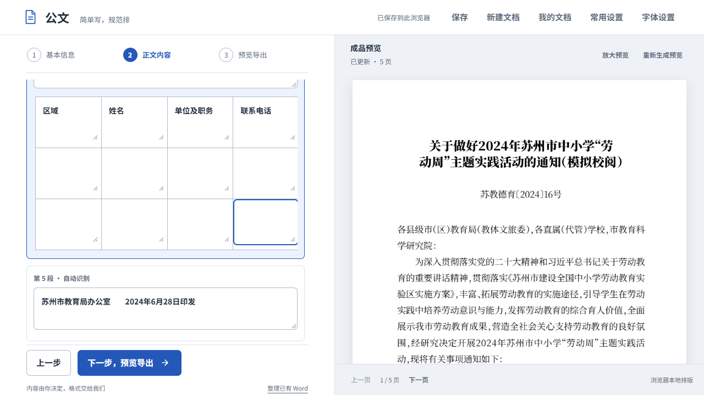
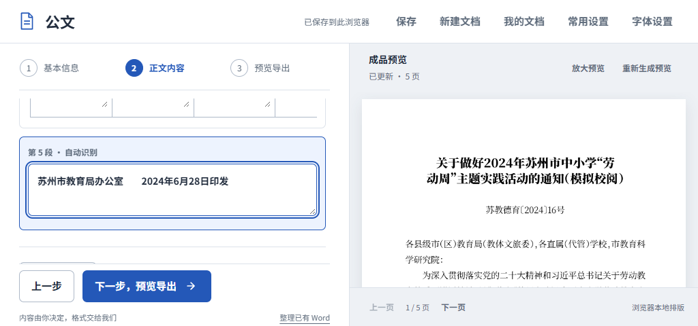

# 整篇整理后的回执继续在原位置编辑

2026-10-22；CEO-002/004最新P1和CEO-005条件路径。来源main3dba41e4、CEO文件d25f89f4；继续同一codex/ceo-004-materials/PR5，不新开任务链，不合并或公开部署。

## 补齐自然整理与同稿编辑之间的断点

上版35b23d9已能编辑正文表格，但自然选择标题、收文对象、落款、日期及后文后，回执进入独立纯文字附注。CEO的教育任务因此必须先手工搬回正文；其实际文件成功并不能证明自然衔接顺畅。这个缺口已在本轮补齐，未要求用户预知模型边界或改变整理选择。

落款后内容提供相同的段落和表格工具，署名/历史日期仍在独立字段。对这份公开教育通知：照常整篇粘贴并确认用途，在落款后的“参会回执”位置点击添加表格，弹窗展示原有四列表头与两行空白，确认即原位转换为3×4网格。表头不重录，正文、署名日期、公开说明、回执、表后印发信息保留原序；无需撤销整篇整理、搬回正文、下载导入或清空独立字段。普通文字不推断成表，制表符内容仍由作者确认。取消不改原稿，行列不足拒绝截断；已有表格后再插表不默认转换其后的印发信息。

两个编辑区分别保存撤销/重做历史，撤销正文不覆盖后来编辑的回执，反向也一样。附注段落/单元格提醒绑定本区真实源，标明行列并准确聚焦；相关内容变化重判，无关正文修改不误撤销局部判断。空白表格保留，未为本轮额外修改空白单元格建议规则。

含落款后结构的草稿用v5保存同稿身份、两个区域和派生文字，兼容读取v1–v4。选择独立版本是为旧代码不认识时明确保护原件，避免旧v4读者无声压平新增结构。正文与附注文字不一致或身份重复时保留原始恢复数据；延迟/缺失模块时两个区域均保护为只读，仍可填写其他信息和下载完整应急稿。附注沿用4000字符上限，表格沿用1–100行、1–10列等宽网格边界，不新增附件管理系统。

## 结构输入的两处收尾修复

旧版基线在空闲预览后模拟组合输入，段落和单元格的相同值compositionend后仍处于修改待更新；随后再发相同值非组合input也不能补调度。每步观察750ms并结合源码说明无新调度，不把短观察写成用户全部“永久”等待的复现。

独立DOM探针在Chrome155、Firefox157、WebKit27.2中都观察到：新textarea不支持oncompositionend属性式处理器，给该属性赋函数后合成结束事件调用数为0，addEventListener调用数为1。仅补相等分支仍使首轮Chrome用例等到120秒超时，因此本轮同时改为明确事件监听，并让未改变内容的非组合收尾调用预览调度；不制造多余正文变更或撤销记录。正文和落款后区域的段落/单元格都适用，不需要再碰其他字段。

这是浏览器事件契约和确定条件路径的实证。没有操作用户前台或Windows真实中文选词，不能扩大为所有真实IME通过，也不能将其定为用户原始等待报告的唯一根因。日期、30秒完整管线恢复和最新稿导出约束继续保留。

## 当前验收

| 路径 | 本轮结果 |
| --- | --- |
| 公开教育通知自然整理→原位回执 | 三浏览器48项；包括取消/拒绝截断、无重录转换、独立撤销、精确单元格判断及保存重开、标题修改、实际Word/PDF/v5下载；主任务无文件搬运 |
| 结构组合结束 | 三浏览器30项；正文/落款后各段落与单元格，无最终input及相同值最终input均收敛，实际文件含最后四处输入；旧基线四个断点检查及监听探针另存 |
| v5失败/应急保护 | Chrome18项，延迟/缺失模块、完整v5下载、存储配额失败恢复、失败切换/取消和矛盾数据保护 |
| 模型与既有回归 | Node66；正文同稿两任务87、普通字段/超时收敛30、提醒66、启动33通过；真实4173首次使用16、跨标签及旧缓存升级通过 |
| 实际文件 | 六组Word/PDF精确全文/顺序/XML核验，PDF共18页文字；教育唯一文字增量为标题的模拟校阅后缀，3×4表头及八个有意空白格、历史署名日期、印发信息保留 |
| 当前真实页面 | 隐藏Word16.0教育5页/组合样稿1页，直接PDF对应5页/1页，共12页全部渲染查看；Word下载字节与当前文件相同 |
| 低高度 | 1280×720主任务；1024×480最后回执格、Tab到其后印发文字、根页面不滚和下一步常驻通过 |

[证据与源码哈希](evidence/postscript-workspace/verified.json)、[回执任务](evidence/postscript-workspace/receipt-checks.json)、[结构输入](evidence/postscript-workspace/structure-ime.json)、[旧基线](evidence/postscript-workspace/structure-ime-baseline.json)、[监听探针](evidence/postscript-workspace/handler-probe.json)、[v5保护](evidence/postscript-workspace/v5-recovery.json)、[Word记录](evidence/postscript-workspace/word-render.json)随Git保存。脚本为scripts/test-writer-postscript-receipt.mjs、test-writer-structure-ime.mjs、verify-writer-postscript-workspace.py，RECOVERY_SUFFIX=1运行test-writer-content-recovery.mjs。先构建到build/qa/inline-workspace-web；旧基线单独固定于上版35b资产，不能用新构建冒充旧版。

## 保留的边界

本题没有修改Go生产引擎、文档字体或通用分页。教育通知Word和PDF虽同为五页，换行/字距仍不同：Word网址附近的两端对齐字距明显，公开说明在Word第4页而直接PDF第5页，回执及其后印发信息均在第5页。代表页未见裁切、重叠、漏线或内容丢失，不宣称正式印发级布局或两种格式逐页一致。转换只识别显式制表符，不承诺从任意空格、图片、PDF或外来Word自动还原原表。手机、Safari真机、物理打印及真实中文选词未新增完成声明。

本轮新版在通过验收后同步本地http://127.0.0.1:4173；继续原隐藏回环服务，不上传文稿、不配置开机启动。当前可运行源码与真实HTTP字节的对应以本轮证据和tmp/local-preview/state.json核对，不将35b独立体验的文件当成本轮新验收，也不代CEO签收新修订。
