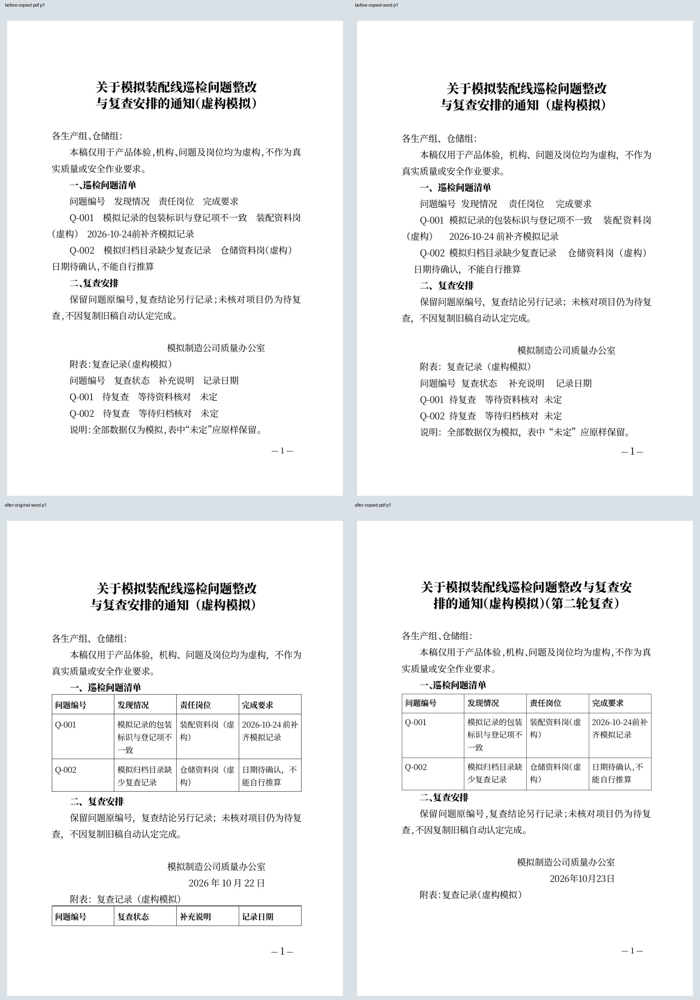
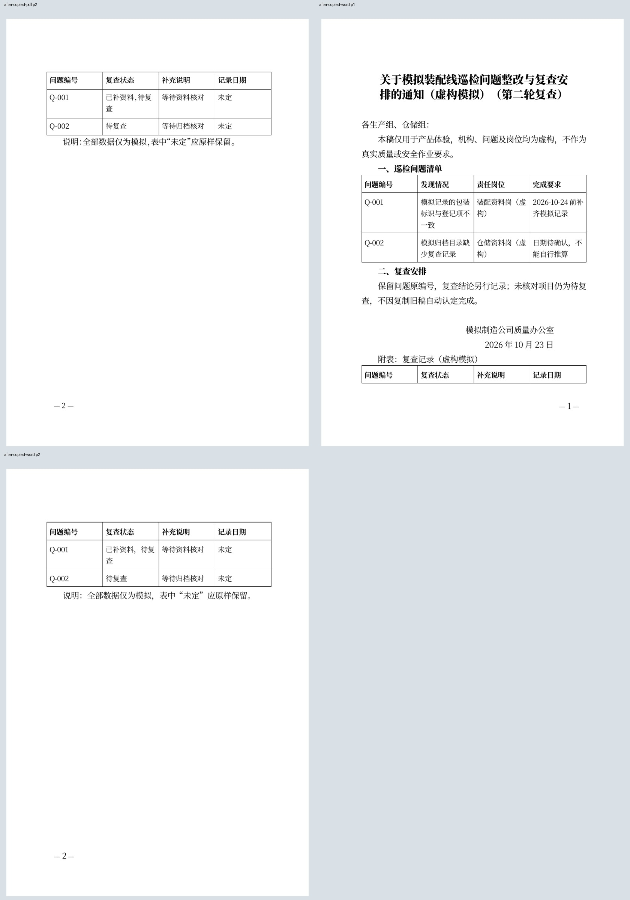

# 制造企业质量文员：复制旧整改通知时保留两张表格

2026-10-22；用户明确要求继续具体行业完整任务，发现问题自主修复、验收并更新同一PR #5。本轮沿既有CEO-002/004的同稿连续编辑/保存交付范围，不新增产品模块。

## 具体工作与已复现问题

以质量文员复用巡检整改通知、编制第二轮复查稿为目标：整篇整理→正文问题清单和落款后复查表→保存归档→从“我的文档”旧稿列表复制→修改复查状态/标题/日期→刷新→导出→返回原稿核对。机构、问题、岗位与日期均为明确标记的虚构材料，不涉及真实生产或安全要求。实施者知情的正常UI任务，不是无历史用户研究；独立无头浏览器不操作用户原标签或前台，无草稿/存储注入。

旧版实际复现：列表中的“复制新稿”保留文字，却遗漏content，v5双表稿降为普通文本稿，正文问题表与落款后复查表均消失；实际Word中0张表，PDF也失去网格。日期/文号清空本来就是预期行为，不属于丢失缺陷。当前稿下方“复制当前文档”已有完整结构传递，此问题只在最近列表的复制入口。

## 最小修复与新行为

仅补齐web/write.js里列表复制调用的完整content参数，复用现有draft校验/深复制。不新增按钮、不切换编辑模式、不改变日期/文号清空或判断隔离规则，不改字体、文档引擎或分页。

复制后仍是新身份，独立日期和文号为空，两张3×4表、24格、段落角色/格式/顺序及原材料完整。质量文员将Q-001复查状态明确改为“已补资料，待复查”，填写新稿日期2026-10-23、标题增加第二轮复查后，保存刷新与导出保留；Q-002的“未定”和完成要求不推算不改写。返回原稿仍为原日期、原状态和两张表。

## 当前验证

- 旧构建Chrome完整任务重现及4份实际Word/PDF；新构建Chrome/Firefox/WebKit各6项任务核对，共18项通过，并取得12份实际文件。关联文档库/结构/附注模型Node25项通过。
- 独立核验共16份真实Word/PDF，15页直接PDF全文，逐字顺序和两表24格一致；旧副本Word0表，新副本2表。原稿337非空白字、旧副本326（按预期清空独立日期），新复查副本349（明确标题/状态修改及新日期），不同输入不冒称全文前后相同。
- 隐藏Word16.0只读核对Chrome前后原稿/副本四份当前文件，逻辑全文SHA和源下载绑定；四份直接PDF7页、Word转PDF7页，共14实际页，11不同像素页全部查看，无切字、缺字、重叠或表线丢失。原稿前后均2页；旧副本1页正是表结构丢失的结果，新副本2页不是排版退化。
- 实际4173同步相同验收构建后，再次经UI完成6项任务和4份新下载全文/两表核对，HTTP write.js及Wasm与QA/服务文件哈希一致。服务保留原隐藏进程，未配置开机启动；旧标签未被强制刷新。HTTP来源哈希不扩大为浏览器已加载字节认证。

[完整文件与结构校验](evidence/quality-copy/verified.json)、[原生Word](evidence/quality-copy/word-render.json)、[实际本地服务复验](evidence/quality-copy/service.json)。前后真实输入、UI截图、三浏览器结果与页组同目录保存。

## 边界与复现

Word复查表在第一页末出现表头，第二页重复表头后放数据；直接PDF表格在第二页，附表标题仍在第一页。此为已有分页边界，未在这个复制修复中声称消除。两页完整交付，不只分发首页；不以Word/PDF同页数当作逐页一致。真实中文选词、手机、真机Safari、物理打印和真实用户效率未新增通过声明；Firefox/WebKit本轮独立核对Word XML/PDF文字，原生Word仅四份Chrome文件。

先在旧实际服务运行node scripts/test-writer-quality-copy.mjs --expect-copy-loss；修复构建到build/qa/quality-copy-web，QUALITY_BUILD指向该目录、QUALITY_PROFILE分别chrome/firefox/webkit再运行同脚本。四份Chrome Word按before/after-original/copied复制到build/qa/quality-copy/word，隐藏Word记录全文SHA/源SHA/页数并导出同名.word.pdf，用scripts/verify-writer-quality-copy.py独立核验和渲染。QUALITY_OUTPUT可指定独立服务复验目录，避免覆盖QA结果。图片须实际查看，脚本不自动宣称视觉通过。

一次内联隐藏Word命令退出且未生成文件，未认定为产品故障；保存脚本后四文件全部完成。服务只在三浏览器和页图验收后更新。此次只修复可重现的列表复制断点，不合并PR或公开部署。
